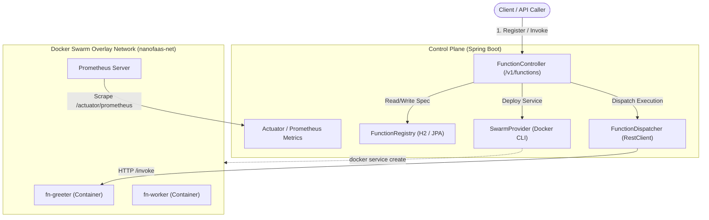

# mini_nanofaas

Una piattaforma **Function-as-a-Service (FaaS)** didattica, leggera e modulare ispirata a [nanofaas](https://github.com/miciav/nanofaas).  
Il progetto è realizzato con **Java 25**, **Spring Boot 4.x** e **Docker Swarm**.
---

## 🏛️ Architettura

Il sistema si compone di 4 moduli architetturali chiave:



1. **REST API & Control Plane**: Endpoint di gestione per registrare specifiche di funzioni (`POST /v1/functions`) e invocarle sincronicamente (`POST /v1/functions/{name}:invoke`).
2. **Function Registry**: Catalogo delle funzioni registrate (`FunctionSpec`), con persistenza tramite Spring Data JPA e database H2.
3. **Swarm Provider**: Gestore del ciclo di vita dei container su cluster Docker Swarm (`create`, `scale`, `remove`, health-check).
4. **Dispatcher**: Routing e inoltro HTTP delle richieste direttamente ai container/servizi dedicati sulla rete overlay (`http://fn-<name>:8080/invoke`).

---

## 🚀 Stack Tecnologico

- **Linguaggio**: Java 25
- **Framework**: Spring Boot 4.1.x
- **Build Tool**: Gradle (Wrapper)
- **Container Orchestration**: Docker Swarm con overlay network (`nanofaas-net`)
- **Ambiente Isolato & Provisioning**: Multipass (Ubuntu VM) + script Python
- **Osservabilità**: Spring Boot Actuator, Micrometer, Prometheus

---

## 📋 Specifiche di una Funzione (`FunctionSpec`)

Ogni funzione registrata è descritta da un payload JSON:

```json
{
  "name": "greeter",
  "imageDigest": "repo/greeter:latest",
  "replicas": 1,
  "timeoutSeconds": 30
}
```

---

## 🛠️ API Endpoints

| Metodo | Endpoint | Descrizione | Status Code |
| :--- | :--- | :--- | :--- |
| `POST` | `/v1/functions` | Registra una nuova funzione | `201 Created` / `409 Conflict` |
| `POST` | `/v1/functions/{name}:invoke` | Inoltra ed esegue una chiamata alla funzione | `200 OK` / `404 Not Found` |
| `GET` | `/actuator/prometheus` | Metriche per il monitoring con Prometheus | `200 OK` |
| `GET` | `/actuator/health` | Health check del Control Plane | `200 OK` |

---

## 🧭 Roadmap di Sviluppo

Lo sviluppo è tracciato dettagliatamente all'interno di [ROADMAP.md](ROADMAP.md):

- [x] **Fase 1**: Core Control Plane (API REST, Dispatcher, Registry in memoria).
- [ ] **Fase 1 (completamento)**: Integrazione metriche Prometheus e persistenza catalogo con Spring Data JPA + H2.
- [ ] **Fase 2**: Script Python di provisioning ambiente con Multipass e containerizzazione di Spring Boot.
- [ ] **Fase 3**: Implementazione dello Swarm Provider per la gestione del ciclo vita dei container.
- [ ] **Fase 4**: Deploy server Prometheus, container funzione demo e CLI Python per sviluppatori.
- [ ] **Fase Futura**: Stateful Serverless via Watchdog sidecar in Rust con storage di stato distribuito su Redis.

---

## 💻 Come Avviare in Locale (Sviluppo)

### Prerequisiti
- **JDK 25** installato e configurato (`JAVA_HOME`).
- **Docker** (per le fasi successive di test container).

### Compilazione e Avvio

```bash
# Clona il repository
git clone https://github.com/LucaBasanisi/mini_nanofaas.git
cd mini_nanofaas

# Compilazione ed esecuzione dei test
./gradlew test

# Avvio del Control Plane
./gradlew bootRun
```

Il server sarà in ascolto su `http://localhost:8080`.
