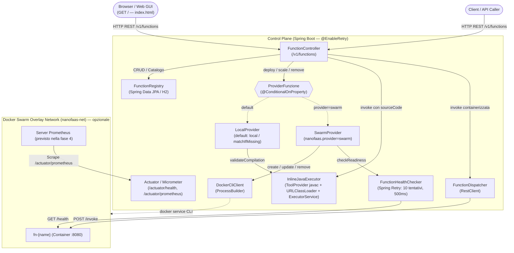

# mini_nanofaas

Una piattaforma **Function-as-a-Service (FaaS)** didattica, leggera e modulare ispirata a [nanofaas](https://github.com/miciav/nanofaas).  
Il progetto è realizzato con **Java 25** e **Spring Boot 4.1.x**, è eseguibile **in locale senza Docker** tramite provider locale di default (`LocalProvider`), compilazione/esecuzione **Java inline** (`InlineJavaExecutor`) e **Web GUI** integrata (`/`), e supporta opzionalmente il deploy su **Docker Swarm** (`nanofaas.provider=swarm`)

---

## 🏛️ Architettura

Il Control Plane applica il principio di **Dependency Inversion** tramite l'interfaccia `ProviderFunzione` e supporta due modalità operative selezionate a boot via `@ConditionalOnProperty`:
- **Modalità Locale (default)**: attiva `LocalProvider` (`matchIfMissing = true`) ed esegue funzioni Java scritte inline attraverso `InlineJavaExecutor`, senza dipendere da Docker.
- **Modalità Docker Swarm (opzionale)**: attiva `SwarmProvider` impostando `nanofaas.provider=swarm`, orchestrando container dedicati sulla rete overlay `nanofaas-net`.



I componenti principali del sistema sono:

1. **Web GUI (`src/main/resources/static/index.html`)**: console single-page in HTML/CSS/JS vanilla servita su `GET /`, dotata di preset pronti all'uso, editor Java inline, elenco funzioni con filtro e toggle per funzioni inattive (`0` repliche), controlli di scaling/riattivazione/eliminazione, modale di ispezione codice, form `:invoke` e grafico `<canvas>` della latenza in tempo reale.
2. **REST API & Control Plane (`FunctionController`)**: espone gli endpoint `/v1/functions` per listare (`GET`), registrare (`POST`), invocare (`POST /{name}:invoke`), scalare (`POST /{name}/scale`) ed eliminare (`DELETE /{name}`) funzioni. In invocazione instrada le funzioni con `sourceCode` verso `InlineJavaExecutor` (gestendo `HTTP 503` su `0` repliche e `HTTP 504` con scale-to-0 automatico su timeout) e le funzioni containerizzate verso `FunctionDispatcher`.
3. **Function Registry (`FunctionRegistry` + `FunctionRepository`)**: catalogo delle funzioni (`FunctionSpec`, incluso il campo `@Lob sourceCode`) persistito tramite **Spring Data JPA** su database **H2** in-memory.
4. **Astrazione Provider (`ProviderFunzione`)**:
   - **`LocalProvider`** (`@ConditionalOnProperty(name = "nanofaas.provider", havingValue = "local", matchIfMissing = true)`): attivo di default; valida la compilazione del codice inline in fase di `deploy()` e gestisce `scale()` / `remove()` in locale senza Docker.
   - **`SwarmProvider`** (`@ConditionalOnProperty(name = "nanofaas.provider", havingValue = "swarm")`): delega i comandi `docker service` a **`DockerCliClient`** (`ProcessBuilder`, isolato per test unitari con mock) e la verifica di avvio a **`FunctionHealthChecker`** (polling HTTP su `/health` gestito con **Spring Retry**: fino a 10 tentativi con backoff di 500 ms e `@Recover`).
5. **Runtime Java Inline (`InlineJavaExecutor`)**: ricompila il sorgente a ogni invocazione con la JDK Compiler API. Un nuovo `URLClassLoader` carica la classe nella JVM del control plane e un thread dedicato esegue `handle(String)`. Il codice inline condivide i permessi del processo ed è pensato per sorgenti fidati.
6. **Dispatcher (`FunctionDispatcher`)**: inoltra tramite `RestClient` le invocazioni HTTP per funzioni containerizzate sulla rete overlay Docker Swarm (`http://fn-<name>:8080/invoke`).
7. **Osservabilità (`Actuator / Prometheus`)**: espone gli endpoint `/actuator/health` e `/actuator/prometheus` configurati in `application.properties`.

---

## 🚀 Stack Tecnologico

- **Linguaggio**: Java 25 (toolchain Gradle configurata su JDK 25; necessario un **JDK** completo per `ToolProvider.getSystemJavaCompiler()` in modalità inline Java)
- **Framework**: Spring Boot `4.1.1` (famiglia `4.1.x`) — `spring-boot-starter-web`, `spring-boot-starter-webmvc`, `spring-boot-starter-actuator`
- **Persistenza**: Spring Data JPA + database H2 in-memory
- **Resilienza / Readiness**: Spring Retry `2.0.11` (`@EnableRetry`, `@Retryable`, `@Recover`) + `spring-aspects`
- **Esecuzione Java inline** con JDK Compiler API, `URLClassLoader` ed `ExecutorService`. Il compilatore serve anche a runtime. Lo stage finale del Dockerfile usa un JRE ed è destinato al provider Swarm.
- **Web GUI**: HTML5 / CSS3 / JavaScript vanilla (nessun framework o build frontend esterno; grafico latenza su HTML5 `<canvas>`)
- **Build & Test Tool**: Gradle Wrapper (`9.8.1`) + JUnit Platform (`./gradlew test`)
- **Container Orchestration (opzionale)**: Docker Swarm con rete overlay `nanofaas-net` (richiesto solo con `nanofaas.provider=swarm`)
- **Provisioning VM (opzionale)**: Multipass (Ubuntu 24.04) + configurazione dichiarativa `infra/cloud-init.yaml` *(lo script Python `generate_docs.py` presente nel repository serve unicamente a generare gli export Repomix per NotebookLM, non al provisioning infrastrutturale)*
- **Osservabilità**: Spring Boot Actuator, Micrometer, registry Prometheus (`/actuator/prometheus`)

---

## 📋 Specifiche di una Funzione (`FunctionSpec`)

Ogni funzione registrata è descritta da un payload JSON persistito come entità JPA (`FunctionSpec`). Il sistema supporta sia funzioni **Java inline** (modalità locale) sia funzioni **containerizzate** (modalità Docker Swarm).

Esempio per funzione **Java inline** (`imageDigest` è opzionale: se omesso o vuoto, `FunctionController.register()` lo imposta automaticamente a `"inline-java"`):

```json
{
  "name": "saluta",
  "imageDigest": "inline-java",
  "sourceCode": "public class Function { public static String handle(String input) { return \"Ciao, \" + (input == null ? \"mondo\" : input) + \"!\"; } }",
  "replicas": 1,
  "timeoutSeconds": 5
}
```

Esempio per funzione **containerizzata Docker Swarm**:

```json
{
  "name": "greeter",
  "imageDigest": "repo/greeter:latest",
  "replicas": 1,
  "timeoutSeconds": 30
}
```

### Campi del Modello e Regole di Validazione

| Campo | Tipo Java / JPA | Obbligatorio | Vincoli & Validazione | Comportamento / Note operative |
| :--- | :--- | :--- | :--- | :--- |
| `name` | `String` (`@Id`) | Sì | Non nullo e non composto da soli spazi (`!name.strip().isEmpty()`). | Chiave primaria nel database H2. In modalità Swarm genera il nome servizio `fn-<name>`. |
| `imageDigest` | `String` | Condizionale (obbligatorio se `sourceCode` è assente) | Almeno uno tra `imageDigest` (non blank) e `sourceCode` (non blank) deve essere valorizzato (`hasValidConfiguration()`). | Tag/digest immagine Docker. Se omesso/blank in presenza di `sourceCode`, `FunctionController.register()` imposta automaticamente `"inline-java"`. |
| `sourceCode` | `String` (`@Lob`, `length = 10000`) | Condizionale (obbligatorio se `imageDigest` è assente) | H2 lo memorizza come CLOB. `length = 10000` è un’indicazione per JPA. Un sorgente vuoto o di soli spazi bianchi è trattato come assente. L’API non verifica la lunghezza massima. | Sorgente Java inline compilato ed eseguito da `InlineJavaExecutor`. **Precedenza**: in `invoke()`, se `hasSourceCode()` è `true`, l'esecuzione inline ha sempre la precedenza su `FunctionDispatcher`. |
| `replicas` | `int` | No (se omesso vale `0`) | `replicas >= 0` (`setReplicas` / `updateReplicaCount` lanciano `IllegalArgumentException` -> `HTTP 400` se `< 0`). | `0` indica funzione registrata ma inattiva/a riposo (`HTTP 503` su `:invoke` inline). In locale funge da interruttore attivo (`> 0`) / inattivo (`0`). |
| `timeoutSeconds` | `int` | Sì | `timeoutSeconds > 0` (`setTimeoutSeconds` lancia `IllegalArgumentException` se `<= 0`; l'omissione nel JSON lascia `0`, respinto da `hasValidConfiguration()`). | Secondi di attesa del risultato di `handle` sul percorso inline. Il dispatcher HTTP per i container non usa questo valore. |

### Contratto del Codice Java Inline (`InlineJavaExecutor`)

- **Requisito JDK**: la compilazione sfrutta `ToolProvider.getSystemJavaCompiler()` (`javac`), pertanto richiede l'esecuzione su un **JDK 25 completo** (non un semplice JRE, pena `IllegalStateException` / `HTTP 500`).
- **Default package obbligatorio**: il sorgente **non** deve includere la direttiva `package ...;`. Il file viene scritto come `<className>.java` in una directory temporanea dedicata e caricato tramite `URLClassLoader` isolato per invocazione (ripulito nel blocco `finally`, senza cache tra chiamate).
- **Rilevamento nome classe**: `InlineJavaExecutor` cerca prima `public class <Nome>` e in fallback `class <Nome>` tramite espressione regolare sul testo grezzo; evitare sequenze `class ...` in commenti o stringhe prima della dichiarazione effettiva della classe.
- **Firma del metodo**: deve esporre un metodo pubblico `handle(String input)` (forma consigliata `public static String handle(String input)`; supportato anche il metodo di istanza `public String handle(String input)` se la classe ha costruttore pubblico senza argomenti). Un valore di ritorno `null` viene convertito in stringa vuota `""`.
- **Timing dei controlli**: `POST /v1/functions` in modalità locale valida la sola compilazione `javac` (`LocalProvider.deploy()` -> `validateCompilation()`); la presenza della firma `handle(String)` è verificata a runtime durante `:invoke` (`HTTP 400` se assente).
- **Timeout e risposta HTTP.** Il timer parte dopo la compilazione, l’inizializzazione della classe e l’eventuale costruttore. Alla scadenza il server interrompe il thread di `handle` e attende che termini. Se il metodo continua a lavorare, anche la risposta resta in attesa. Quando il controllo torna al controller, questo chiede al provider di scalare a zero, aggiorna la riga in H2 e risponde `504`. Il normale ciclo locale è quindi `504` → funzione ancora in catalogo → `503` alla chiamata successiva → riattivazione con `/scale?replicas=1`.

---

## 🛠️ API Endpoints

| Metodo | Endpoint | Parametri / Body | Comportamento | Status Code HTTP |
| :--- | :--- | :--- | :--- | :--- |
| `GET` | `/` | — | Serve la **Web GUI** single-page (`src/main/resources/static/index.html`) | `200 OK` |
| `GET` | `/v1/functions` | — | Restituisce l'elenco JSON di tutte le `FunctionSpec` salvate in H2 (attive e inattive a `0` repliche, incluso `sourceCode`) | `200 OK` |
| `POST` | `/v1/functions` | Body JSON (`FunctionSpec`, `application/json`) | Valida `hasValidConfiguration()`, imposta `imageDigest="inline-java"` se blank con `sourceCode`, verifica duplicati in H2, esegue `provider.deploy()` (compilazione `javac` in locale oppure `docker service create` + readiness `/health` su Swarm) e salva in H2 | `201 Created` (body: `FunctionSpec`)<br>`400 Bad Request` (configurazione non valida, errori di compilazione Java o JSON malformato)<br>`409 Conflict` (funzione già registrata)<br>`500 Internal Server Error` (fallimento `deploy` Swarm o assenza JDK in runtime) |
| `POST` | `/v1/functions/{name}:invoke` | Path: `{name}`<br>Body (opzionale): payload `text/plain` | Se `hasSourceCode()`: verifica `replicas > 0`, compila il sorgente e attende il risultato di `handle(input)`. In caso di timeout richiede lo scaling a zero e aggiorna il catalogo. Il controller ignora gli esiti booleani delle due operazioni. Altrimenti inoltra via `FunctionDispatcher` a `http://fn-{name}:8080/invoke` | `200 OK` (output testuale)<br>`400 Bad Request` (errore compilazione o firma `handle(String)` assente)<br>`404 Not Found` (funzione non registrata)<br>`503 Service Unavailable` (funzione inline con `replicas == 0`)<br>`504 Gateway Timeout` (superato `timeoutSeconds`: funzione scalata a `0` repliche)<br>`500 Internal Server Error` (eccezione runtime della funzione, assenza JDK o errore di rete verso container Swarm) |
| `POST` | `/v1/functions/{name}/scale` | Path: `{name}`<br>Query: `?replicas=N` (`int`) | Valida `replicas >= 0`, verifica esistenza in H2, invoca `provider.scale(name, N)` e aggiorna `replicas` in H2 | `200 OK`<br>`400 Bad Request` (`replicas < 0` o parametro non valido)<br>`404 Not Found` (funzione inesistente)<br>`500 Internal Server Error` (fallimento `provider.scale`) |
| `DELETE` | `/v1/functions/{name}` | Path: `{name}` | Verifica esistenza in H2, invoca `provider.remove(name)` e rimuove la funzione da H2 | `200 OK`<br>`404 Not Found` (funzione inesistente)<br>`500 Internal Server Error` (fallimento `provider.remove`) |
| `GET` | `/actuator/health` | — | Health check del Control Plane (`application.properties`) | `200 OK` |
| `GET` | `/actuator/prometheus` | — | Metriche Micrometer in formato Prometheus (`application.properties`) | `200 OK` |

> *(Nota operativa)*: la guardia preventiva `503` su `replicas == 0` e la disattivazione automatica a `0` repliche con `504 Gateway Timeout` si applicano al percorso di esecuzione **Java inline** (`hasSourceCode() == true`). Le funzioni prive di `sourceCode` vengono inoltrate direttamente da `FunctionDispatcher` verso `http://fn-<name>:8080/invoke` (previsto per la rete overlay Docker Swarm).

---

## 🧭 Roadmap di Sviluppo

Lo sviluppo è tracciato dettagliatamente all'interno di [ROADMAP.md](ROADMAP.md):

- [x] **Fase 1**: Core Control Plane (API REST, Dispatcher, Registry H2/JPA, Metriche Prometheus, Pipeline CI).
- [x] **Fase 2**: Provisioning VM con Multipass & `cloud-init`, Dockerfile multi-stage, Pipeline CD su GHCR, deploy su Docker Swarm ed export NotebookLM.
- [x] **Fase 3**: Provider Swarm & Locale (`@ConditionalOnProperty`), refactoring DIP/Rich Domain Model, esecuzione Java inline (`InlineJavaExecutor`) con scale-to-0 su timeout (`504`/`503`), API catalogo (`GET /v1/functions`), Web GUI (`index.html`) e test E2E HTTP.
- [ ] **Fase 4**: Funzione demo `test-greet`, deploy server Prometheus su Swarm, test E2E Swarm e CLI Python per sviluppatori.
- [ ] **Fase 5**: Serverless Workflow Engine & Reti di Petri (WF-Nets, Verifica Formale di Soundness & Pre-warming Predittivo).
- [ ] **Fase 6**: Resilienza Distribuita, Concorrenza & Doppia Sorgente di Verità (Circuit Breaker, Locking, Reconciliation Loop).
- [ ] **Fase 7**: Architettura DDBMS & Stateful Serverless (Persistenza distribuita, WAL/Snapshot, Fencing Tokens & State Rehydration).
- [ ] **Fase 8**: Chaos Engineering, Fault Injection & Stress Testing.
- [ ] **Fase 9**: Ottimizzazione Prestazioni, Cold Start & JVM Next-Gen: AOT Cache (Project Leyden) e CRaC.

---

## 🚀 Guida all'Installazione e Avvio Rapido

`mini_nanofaas` supporta **due modalità operative** selezionabili tramite la proprietà Spring `nanofaas.provider`:
- **Modalità Locale Standalone (`LocalProvider`, predefinita)**: avvio diretto sull'host con `./gradlew bootRun`, database H2 in-memory, Web GUI su `http://localhost:8080/` ed esecuzione immediata di funzioni Java inline senza necessità di Docker o Multipass.
- **Modalità Cluster Docker Swarm (`SwarmProvider`, `nanofaas.provider=swarm`)**: esecuzione distribuita di container funzione su VM Ubuntu tramite Multipass (`infra/cloud-init.yaml`) e rete overlay `nanofaas-net`.

---

### Opzione A — Avvio Rapido Locale (`LocalProvider`, default)

#### 1. Prerequisiti
- **Git** installato sulla macchina host.
- **JDK 25 completo** (non un semplice JRE): richiesto sia dal toolchain Gradle (`build.gradle`) sia a runtime da `InlineJavaExecutor` per invocare `javac` tramite `ToolProvider.getSystemJavaCompiler()`.

#### 2. Clonazione e Avvio
```bash
git clone https://github.com/LucaBasanisi/mini_nanofaas.git
cd mini_nanofaas
./gradlew bootRun
```
- Poiché `application.properties` non imposta `nanofaas.provider`, Spring Boot attiva automaticamente `LocalProvider` (`matchIfMissing = true`).
- Il database **H2** parte in-memory: le funzioni registrate restano disponibili per la durata del processo e vengono azzerate al riavvio. Per provare il percorso locale, registra una funzione con `sourceCode`. Una richiesta con la sola immagine può ricevere `201` anche in locale, ma il provider locale non avvia il servizio che il dispatcher cercherà alla prima invocazione.

#### 3. Utilizzo della Web GUI (`http://localhost:8080/`)
Apri `http://localhost:8080/` nel browser per accedere alla console single-page (`src/main/resources/static/index.html`), composta da 4 riquadri principali:
- **Registra Funzione**: include 4 preset pronti in 1 clic (`Saluta` → `saluta`, `Maiuscolo` → `maiuscolo`, `Analizza testo` → `analizza-testo`, `Simula Timeout` → `test-timeout`), editor Java per `public static String handle(String input)`, campi `Repliche iniziali` (min `0`, default `1`) e `Timeout (sec)` (min `1`, default `5`), e sezione espandibile *"Opzioni avanzate (Immagine Docker)"* con default `inline-java`.
- **Funzioni**: interroga `GET /v1/functions`, permette di filtrare per nome e include il toggle **"Mostra inattive (0 repliche)"** (disattivo di default: le funzioni portate a `0` repliche da uno scaling o da un timeout vengono nascoste finché non si attiva il toggle; il contatore mostra `X attive · Y inattive`). Ogni riga offre controlli `-`/`+` per lo scaling live, `Invoca`, `Riattiva` (se a `0` repliche), modale `Codice` (con pulsante *"Carica nell'editor"*) ed `Elimina`.
- **Invoca Funzione**: selettore rapido delle funzioni attive (o inserimento manuale), chip di payload pronti (`"Luca"`, `Testo`, `JSON`, `Svuota`), invio rapido con `Ctrl + Invio` (o `Cmd + Invio`), pannello di output testuale con metadati `HTTP <status> · <ms> ms`.
- **Latenza Invocazioni (ms)**: grafico `<canvas>` in tempo reale delle ultime 20 invocazioni (barre verdi per `200 OK`, barre rosse per errori o timeout).

#### 4. Test API via `curl` (Ciclo Completo Locale)

- **Health check**:
  ```bash
  curl http://localhost:8080/actuator/health
  ```
- **Registrazione funzione Java inline** (`imageDigest` omesso → auto-impostato a `"inline-java"`):
  ```bash
  curl -i -X POST http://localhost:8080/v1/functions \
    -H "Content-Type: application/json" \
    -d '{
      "name": "upper-java",
      "sourceCode": "public class Function { public static String handle(String input) { return input == null ? \"EMPTY\" : input.toUpperCase(); } }",
      "replicas": 1,
      "timeoutSeconds": 5
    }'
  ```
  Risposta attesa: `HTTP/1.1 201` con JSON contenente `"imageDigest":"inline-java"`.
- **Lista delle funzioni registrate**:
  ```bash
  curl http://localhost:8080/v1/functions
  ```
- **Invocazione (`200 OK`)**:
  ```bash
  curl -i -X POST http://localhost:8080/v1/functions/upper-java:invoke \
    -H "Content-Type: text/plain" \
    -d "ciao"
  ```
  Risposta attesa: `HTTP/1.1 200`, body `CIAO`.
- **Ciclo Timeout (`504`) → Scale-to-0 automatico → `503` → Riattivazione (`scale`) → Eliminazione (`DELETE`)**:
  ```bash
  # 1. Registra una funzione con timeout 1s che attende 3s
  curl -i -X POST http://localhost:8080/v1/functions \
    -H "Content-Type: application/json" \
    -d '{
      "name": "slow-java",
      "imageDigest": "inline-java",
      "sourceCode": "public class Function { public static String handle(String input) throws Exception { Thread.sleep(3000); return \"done\"; } }",
      "replicas": 1,
      "timeoutSeconds": 1
    }'

  # 2. Invoca -> 504 Gateway Timeout (la funzione scende automaticamente a 0 repliche in H2)
  curl -i -X POST http://localhost:8080/v1/functions/slow-java:invoke \
    -H "Content-Type: text/plain" \
    -d "go"

  # 3. Verifica che la funzione resti registrata in H2 con "replicas":0
  curl http://localhost:8080/v1/functions

  # 4. Nuova invocazione mentre è a 0 repliche -> 503 Service Unavailable
  curl -i -X POST http://localhost:8080/v1/functions/slow-java:invoke \
    -H "Content-Type: text/plain" \
    -d "go"

  # 5. Riattiva scalando a 1 replica -> 200 OK
  curl -i -X POST "http://localhost:8080/v1/functions/slow-java/scale?replicas=1"

  # 6. Pulizia finale -> 200 OK
  curl -i -X DELETE http://localhost:8080/v1/functions/slow-java
  curl -i -X DELETE http://localhost:8080/v1/functions/upper-java
  ```

#### 5. Test Automatici (E2E HTTP & Unit Test)
```bash
./gradlew test
```
La suite comprende 11 test in tre classi. Nei quattro test HTTP il server ascolta su una porta casuale e usa H2 reale. I mock sostituiscono il provider e il dispatcher in tutta la classe. La compilazione inline avviene davvero durante l’invocazione. La verifica di `GET /` legge l’HTML servito, senza eseguire JavaScript.
- `FunctionControllerIntegrationTest` (4 test E2E HTTP con `@SpringBootTest(RANDOM_PORT)` e `HttpClient`):
  1. `webGuiIsServedAtRoot`: verifica `GET /` (`200 OK` e contenuto HTML della Web GUI).
  2. `fullCrudAndInvokeLifecycleViaHttp`: verifica l'intero ciclo `POST /v1/functions` (`201`) → `GET /v1/functions` (`200`) → `POST /scale?replicas=3` (`200`) → `POST :invoke` (`200`) → `DELETE` (`200`) con `ProviderFunzione` e `FunctionDispatcher` mockati via `@MockitoBean`.
  3. `inlineJavaFunctionCompilesAndExecutes`: verifica la compilazione ed esecuzione reale tramite `InlineJavaExecutor` (`"ciao"` → `"CIAO"`, richiede un JDK).
  4. `timeoutDeactivatesFunctionWithoutDeletingRegistration`: verifica che il superamento di `timeoutSeconds` restituisca `504` mantenendo la funzione nel catalogo `GET /v1/functions` con `"replicas":0`.
- `FunctionSpecTest` (6 unit test su validazione invarianti, `updateReplicaCount` e convenzioni URL `fn-<name>`).
- `MiniNanofaasApplicationTests` (1 test di caricamento del contesto Spring Boot).

---

### Opzione B — Ambiente Isolato con Multipass & Docker Swarm (`SwarmProvider`)

Per orchestrare funzioni containerizzate reali su un cluster **Docker Swarm** isolato con rete overlay dedicata tramite **Multipass**:

#### 1. Prerequisiti
- **Git** installato sulla macchina host.
- **Multipass** installato sull'host (`snap install multipass` o gestore pacchetti di sistema).

*(Nota per utenti Fedora/RHEL)*: se `firewalld` è attivo, concedere fiducia ai bridge Multipass per consentire il rilascio dell'IP via DHCP:
```bash
sudo firewall-cmd --permanent --zone=trusted --add-interface=mpqemubrzone1
sudo firewall-cmd --permanent --zone=trusted --add-interface=mpqemubrzone2
sudo firewall-cmd --permanent --zone=trusted --add-interface=mpqemubrzone3
sudo firewall-cmd --reload
```

#### 2. Clonare il Repository
```bash
git clone https://github.com/LucaBasanisi/mini_nanofaas.git
cd mini_nanofaas
```

#### 3. Provisioning della VM con Multipass (`cloud-init`)
Lancia la VM Ubuntu 24.04 indicando il file di bootstrap [infra/cloud-init.yaml](infra/cloud-init.yaml) (che installerà Docker, inizializzerà Docker Swarm e creerà la rete overlay `nanofaas-net`):

```bash
multipass launch 24.04 --name nanofaas-vm --cpus 2 --memory 2G --disk 10G --cloud-init infra/cloud-init.yaml
```

Verifica che la VM sia nello stato `Running` e abbia un IP IPv4 assegnato:
```bash
multipass list
```

#### 4. Accesso alla Shell della VM
Entra direttamente nella shell interattiva della VM:
```bash
multipass shell nanofaas-vm
```

*(Opzionale)* Verifica che Swarm e la rete overlay siano attivi:
```bash
docker info
docker network ls
```

#### 5. Avvio del Control Plane (Docker Swarm Service)
All'interno della shell della VM, avvia il servizio del Control Plane impostando `--env NANOFAAS_PROVIDER=swarm` (oppure `-Dnanofaas.provider=swarm` come argomento JVM). Senza questa impostazione, Spring Boot attiverebbe il provider locale di default (`LocalProvider`) anziché `SwarmProvider`. L'immagine OCI multi-stage viene scaricata da **GitHub Container Registry (GHCR)**:

```bash
docker service create \
  --name control-plane \
  --network nanofaas-net \
  --env NANOFAAS_PROVIDER=swarm \
  --publish published=8080,target=8080 \
  --mount type=bind,src=/var/run/docker.sock,dst=/var/run/docker.sock \
  ghcr.io/lucabasanisi/mini_nanofaas-controlplane:latest
```

> **Nota sul `Dockerfile` (`eclipse-temurin:25-jre` vs JDK)**: lo Stage 2 del [Dockerfile](Dockerfile) utilizza l'immagine runtime minimale `eclipse-temurin:25-jre` (con `docker.io` e `curl`, ma **senza** compilatore `javac`). Tale immagine è pensata per orchestrare container su Docker Swarm (`SwarmProvider.deploy()` esegue `docker service create` sull'`imageDigest` specificato). La compilazione di funzioni Java inline (`sourceCode`) richiede invece un JDK completo (`25-jdk`): eseguita all'interno del container `25-jre`, l'invocazione di `InlineJavaExecutor` fallirebbe con `IllegalStateException` (`HTTP 500`).

Verifica che il servizio abbia raggiunto lo stato desiderato (`1/1` repliche) e consulta i log di Spring Boot:
```bash
docker service ls
docker service logs -f control-plane
```

#### 6. Test e Utilizzo delle API (Modalità Swarm)
Puoi testare gli endpoint sia dall'interno della VM (`localhost:8080`), sia dall'host usando l'IP assegnato da Multipass alla VM (es. `10.89.24.201:8080`):

##### Health Check
```bash
curl http://localhost:8080/actuator/health
```

##### Registrazione e Deploy di una Funzione Containerizzata

Sostituisci `REGISTRY/greeter:TAG` con un’immagine disponibile ai nodi Swarm che ascolti sulla porta 8080, risponda con successo a `GET /health` e implementi `POST /invoke`. La funzione demo è prevista nella fase 4. Se la verifica di readiness fallisce dopo la creazione del servizio, il controller risponde `500` e il catalogo resta privo della voce. Prima di ripetere la registrazione, controlla lo stato del servizio con `docker service ps fn-greeter`.
```bash
curl -i -X POST http://localhost:8080/v1/functions \
  -H "Content-Type: application/json" \
  -d '{
    "name": "greeter",
    "imageDigest": "REGISTRY/greeter:TAG",
    "replicas": 1,
    "timeoutSeconds": 30
  }'
```

##### Invocazione di una Funzione
```bash
curl -X POST http://localhost:8080/v1/functions/greeter:invoke \
  -H "Content-Type: text/plain" \
  -d "Ciao Mondo"
```

---

## 📚 Generazione Documentazione & Fonti per NotebookLM

Il repository include lo script Python [`generate_docs.py`](generate_docs.py) (richiede **Node.js / `npx`** installati sull'host) per estrarre la codebase e la documentazione in formato Markdown deterministico tramite Repomix (`repomix.config.json`), ideale per essere caricato come fonte su **Google NotebookLM** (per generare quiz, flashcard e guide di studio sull'architettura del progetto):

```bash
./generate_docs.py
# oppure: python3 generate_docs.py
```

I file generati vengono salvati in `docs/notebookllm/`:
- `codebase_full.md`: include il codice sorgente completo e i documenti Markdown di specifica.
- `codebase_compressed.md`: contiene l'albero e le sole firme sintetiche di classi, interfacce e metodi (via AST con Repomix Tree-sitter).

