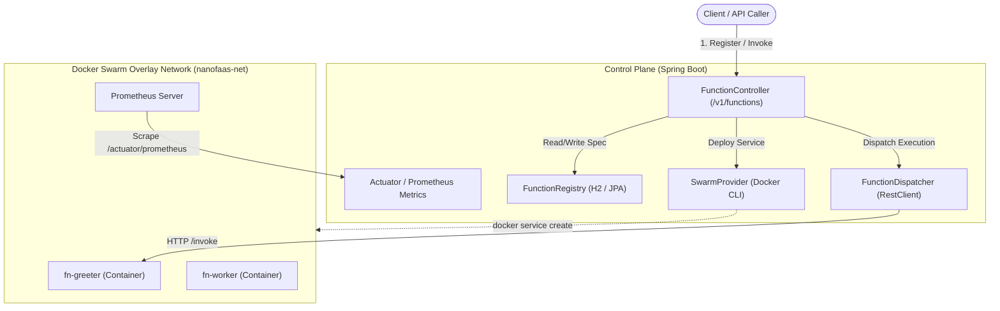

This file is a merged representation of a subset of the codebase, containing specifically included files and files not matching ignore patterns, combined into a single document by Repomix.
The content has been processed where empty lines have been removed, content has been compressed (code blocks are separated by ⋮---- delimiter).

# File Summary

## Purpose
This file contains a packed representation of a subset of the repository's contents that is considered the most important context.
It is designed to be easily consumable by AI systems for analysis, code review,
or other automated processes.

## File Format
The content is organized as follows:
1. This summary section
2. Repository information
3. Directory structure
4. Repository files (if enabled)
5. Multiple file entries, each consisting of:
  a. A header with the file path (## File: path/to/file)
  b. The full contents of the file in a code block

## Usage Guidelines
- This file should be treated as read-only. Any changes should be made to the
  original repository files, not this packed version.
- When processing this file, use the file path to distinguish
  between different files in the repository.
- Be aware that this file may contain sensitive information. Handle it with
  the same level of security as you would the original repository.

## Notes
- Some files may have been excluded based on .gitignore rules and Repomix's configuration
- Binary files are not included in this packed representation. Please refer to the Repository Structure section for a complete list of file paths, including binary files
- Only files matching these patterns are included: src/main/**/*.java, src/main/resources/**/*.properties, src/main/resources/**/*.yml, src/main/resources/**/*.yaml, build.gradle, Dockerfile, README.md, ROADMAP.md, OttimizzaFunzioni.md
- Files matching these patterns are excluded: **/build/**, **/.gradle/**, **/gradlew*, **/*.iml, **/.idea/**, docs/**
- Files matching patterns in .gitignore are excluded
- Files matching default ignore patterns are excluded
- Empty lines have been removed from all files
- Content has been compressed - code blocks are separated by ⋮---- delimiter
- Files are sorted by Git change count (files with more changes are at the bottom)

# Directory Structure
````
src/
  main/
    java/
      com/
        example/
          mini_nanofaas/
            ContainerNotReadyException.java
            DockerCliClient.java
            FunctionController.java
            FunctionDispatcher.java
            FunctionHealthChecker.java
            FunctionRegistry.java
            FunctionRepository.java
            FunctionSpec.java
            MiniNanofaasApplication.java
            ProviderFunzione.java
            SwarmProvider.java
    resources/
      application.properties
build.gradle
Dockerfile
OttimizzaFunzioni.md
README.md
ROADMAP.md
````

# Files

## File: src/main/java/com/example/mini_nanofaas/ContainerNotReadyException.java
````java
/**
 * Eccezione custom usata per segnalare a Spring Retry che il container
 * della funzione non è ancora pronto a ricevere traffico (endpoint /health non risponde o errore).
 * Il framework cattura questa eccezione e attiva automaticamente un nuovo tentativo di retry.
 */
public class ContainerNotReadyException extends RuntimeException {
````

## File: src/main/java/com/example/mini_nanofaas/ProviderFunzione.java
````java
public interface ProviderFunzione {
boolean deploy(FunctionSpec function);
⋮----
boolean remove(String functionName);
⋮----
boolean scale(String functionName, int replicas);
````

## File: Dockerfile
````dockerfile
# Stage 1: Build
FROM eclipse-temurin:25-jdk AS builder
WORKDIR /app

# Copia i file di configurazione Gradle e il wrapper per sfruttare il caching dei layer Docker
COPY gradlew settings.gradle build.gradle ./
COPY gradle ./gradle

# Scarica le dipendenze in anticipo
RUN ./gradlew dependencies --no-daemon || true

# Copia i sorgenti ed esegui la build saltando i test (già verificati in CI)
COPY src ./src
RUN ./gradlew bootJar --no-daemon -x test

# Stage 2: Runtime minimale
FROM eclipse-temurin:25-jre
WORKDIR /app

# Installa la CLI di Docker per consentire a SwarmProvider di eseguire comandi sullo Swarm
RUN apt-get update && \
    apt-get install -y --no-install-recommends docker.io curl && \
    rm -rf /var/lib/apt/lists/*

# Copia il JAR compilato dallo stage precedente
COPY --from=builder /app/build/libs/*.jar app.jar

EXPOSE 8080

ENTRYPOINT ["java", "-jar", "app.jar"]
````

## File: OttimizzaFunzioni.md
````markdown
# **Ottimizzazione Funzioni nanofaas**


*in realtà UPM lo eliminato, dovrei riscrivere il kernel linux e mi sembra un pò troppo complicato*

Esempio funzione Python (per java oppure rust ovviamente sarà diverso):

Watchdog / Control Plane
        │  
        ▼  
Avvio Python Seed Process (carica solo PSL: Flask, runtime base)  
        │  
        ▼  
In attesa di richieste...  
  ┌─────┴────────────────────────────┐  
  Arriva un Burst (N richieste)      Torna in Idle (nessuna richiesta)  
  │                                  │ 
  ▼                                  ▼ 
\[ERUN \- Load\]                      \[ERUN \- Shrink\]  
Carica le FSL (es. numpy)          Scarica le FSL dalla RAM del processo,  
dal singleLibStore sul nodo        torna leggero in attesa del prossimo burst  
  │  
  ▼  
\[MXFaaS \- Fork\]  
Esegue N fork() in Copy-On-Write  
per servire le richieste in parallelo  
condividendo PSL \+ FSL appena caricate\!

# **Piano D’azione**

Costruire un simulatore usando solamente docker swarm (per semplicità) per vedere se questa soluzione è fattibile.  
ERUN  →  contributo principale (implementativo)  
MXFaaS      →  contributo secondario per Python/Go.   
CRaC        →  contributo per Java al posto di MXFaaS

# **Spiegazione delle Tecnologie**

## ERUN

In una situazione di cold start viene creato lo snapshot della funzione. Se siamo in una situazione di warm start, il pod usa ERUN, ovvero Ricarica FSL da singleLibStore.   
Considerazioni: Lo store in-memory condiviso sul nodo previsto da ERUN non solo è realizzabile ma è relativamente semplice se usi container (Docker / Kubernetes). Lo store condiviso a livello di nodo (singleLibStore) non deve far parte del codice Java del Control Plane, ma è un componente infrastrutturale del nodo worker:

* Si crea sul nodo host una directory montata in RAM tramite tmpfs (o usando /dev/shm).  
* Si monta questa directory in modalità read-only (o read-write controllato da un agente locale) come volume condiviso (hostPath in Kubernetes) all'interno di tutti i pod delle funzioni che girano su quello specifico nodo.  
* Quando una funzione in Python esegue il caricamento dinamico (o il reload da snapshot delle FSL), legge direttamente dalle pagine in RAM del tmpfs locale al nodo tramite mmap, ottenendo latenze prossime allo zero senza passare dal disco.

Quando la funzione finisce → Usiamo lo SHRINK di ERUN → Unload FSL, il nodo worker torna in idle. 

## MXFaaS

Implemento MXFaaS, che usa la Copy On Write per creare tante fork della funzione facendogli puntare allo stesso indirizzo di memoria per risparmiare. L'MXContainer di MXFaaS inizializza prima lo stato del container, e solo successivamente, *on demand*, crea un processo per ogni invocazione — in modo che tutte le invocazioni possano condividere lo **stato di memoria non modificato**, minimizzando l'impronta in RAM. 

## Problemi per MXFaaS

La tua soluzione ha un'idea interessante: mantenere un processo Python leggero, caricare le librerie solo quando servono e sfruttare `fork()` per condividere la memoria tra più worker. Il problema è che stai combinando tre meccanismi delicati: gestione dinamica delle librerie, Copy-On-Write e gestione del ciclo di vita dei processi.

Vediamo gli scenari limite in cui l'architettura può rompersi davvero, non semplicemente diventare un po' meno efficiente.

## **1\. Una libreria viene scaricata mentre un worker la sta usando**

Scenario

Il seed ha caricato `numpy`, poi ha creato un worker che sta eseguendo un calcolo.

Worker 1

Sta usando un array NumPy e le funzioni della libreria.

Seed

Riceve il segnale di idle e tenta di scaricare NumPy.

Il worker potrebbe essere ancora attivo quando il seed avvia lo shrink.

Che cosa succede?

Se il seed elimina semplicemente i riferimenti ai moduli, il worker figlio non perde automaticamente i propri riferimenti: dopo `fork()`, i due processi hanno spazi di indirizzamento distinti. Quindi il problema non è necessariamente un crash immediato.

Il problema reale è che:

* il seed potrebbe non liberare la memoria quanto previsto;  
* un worker ancora attivo continua a consumare RAM;  
* se lo shrink comporta la terminazione forzata di processi o altre operazioni non sicure, potresti interrompere richieste in corso;  
* un nuovo burst potrebbe arrivare mentre il vecchio gruppo di worker non è ancora terminato.

Come evitarlo: lo shrink deve avvenire soltanto dopo aver drenato le richieste, verificato che i worker siano terminati e predisposto una transizione di stato sicura.

## **3\. Una libreria nativa lascia un lock bloccato dopo `fork()`**

Possibile deadlock

Questo è uno dei casi più insidiosi in Python, soprattutto con librerie scientifiche.

Immagina che il seed abbia caricato NumPy, che a sua volta utilizzi codice nativo o librerie matematiche multithread come OpenBLAS.

1. Un thread del seed acquisisce un lock interno della libreria.  
2. Il seed esegue `fork()`.  
3. Il worker figlio eredita la memoria, compreso lo stato del lock.  
4. Il thread che possedeva quel lock non esiste nel figlio, perché `fork()` replica soltanto il thread chiamante.

Il worker prova a usare la libreria e rimane bloccato aspettando un lock che nessuno potrà più rilasciare.

Questo scenario non si verifica con ogni libreria né a ogni fork, ma è un rischio concreto quando si combina `fork()` con thread e librerie native.

Conseguenza: una funzione apparentemente innocua può smettere di rispondere senza produrre alcun errore evidente.

Possibile rimedio: controllare la compatibilità delle librerie con `fork()`, evitare fork da processi multithread in stati non sicuri e valutare un diverso metodo di avvio dei worker. Quest'ultima scelta, però, potrebbe compromettere la condivisione della memoria che vuoi ottenere.

## **4\. Arriva un burst enorme mentre stai caricando le librerie**

Concorrenza

Supponiamo che 100 richieste arrivino quasi contemporaneamente e che tutte richiedano la stessa libreria.

Se il sistema non coordina correttamente le richieste, potresti ritrovarti con questa situazione:

* il watchdog rileva il burst;  
* il seed comincia a caricare una libreria da disco;  
* un altro componente interpreta lo stato come non ancora pronto e avvia un secondo caricamento;  
* altre richieste vengono messe in coda oppure tentano di creare worker prima che il caricamento sia terminato.

Se il caricamento avviene correttamente una sola volta, il problema non si presenta. Ma senza sincronizzazione, puoi avere duplicazioni, errori di inizializzazione o richieste gestite in uno stato incoerente.

Possibile rimedio: una macchina a stati esplicita, ad esempio `IDLE → LOADING → READY → DRAINING → SHRINKING`, con un'unica operazione di caricamento per ciascuna generazione di worker.

## **5\. Il seed viene aggiornato dopo il fork, ma i worker non vedono l'aggiornamento**

Coerenza dei dati

Questo caso riguarda soprattutto le librerie o i dati che cambiano durante l'esecuzione.

1. Il seed carica la versione A di una configurazione o di un modello.  
2. Crea otto worker con `fork()`.  
3. Il seed aggiorna la configurazione alla versione B.  
4. I worker continuano a vedere la propria copia logica dello stato precedente.

Il Copy-On-Write non è un sistema di sincronizzazione: le modifiche effettuate nel processo padre dopo il fork non vengono propagate automaticamente ai figli.

Se il tuo sistema aggiorna librerie o modelli mentre i worker sono attivi, potresti quindi avere richieste che usano versioni differenti.

Possibile rimedio: associare ogni gruppo di worker a una versione immutabile delle librerie e dei dati, e creare una nuova generazione quando serve aggiornare qualcosa.

## **6\. Il worker termina, ma il sistema non recupera le risorse**

Esaurimento delle risorse

Immagina un burst continuo, con centinaia di richieste al secondo. Il seed crea un processo per richiesta, ma alcune richieste falliscono e il codice di gestione dei processi non raccoglie correttamente i processi terminati.

Su sistemi Unix, i figli terminati che non vengono raccolti possono diventare processi zombie. Se invece i processi rimangono attivi bloccati su operazioni I/O, consumano risorse reali.

Conseguenze possibili:

* esaurimento del limite di processi;  
* aumento del numero di descrittori di file;  
* crescita della memoria complessiva;  
* aumento della latenza fino al mancato servizio delle richieste.

Possibile rimedio: limite massimo di worker, gestione corretta di `wait()`/`waitpid()`, timeout, terminazione controllata e backpressure. Creare un processo per ogni richiesta non è necessariamente sostenibile, anche quando il fork è veloce.

## **7\. Il processo seed muore e il Control Plane non sa che cosa è successo**

Resilienza

Immagina che il seed carichi correttamente le librerie e generi dieci worker. Poi viene terminato per un errore, un crash nativo o un riavvio del nodo.

Se il Control Plane considera il seed come l'unica fonte di verità, potrebbe perdere lo stato dei worker o non sapere quali richieste siano ancora in esecuzione.

La situazione può essere ancora peggiore se i worker sopravvivono al seed: il sistema potrebbe avviare un nuovo seed e generare altri worker, mentre quelli vecchi continuano a lavorare.

Possibile rimedio: identificativi di generazione, heartbeat, supervisione dei processi, timeout delle richieste e una procedura di recupero che riconcili lo stato desiderato con quello effettivo.

## **8\. Il vero caso limite: il costo dello shrink supera il beneficio**

Prestazioni

Immagina un carico che alterna un burst ogni due secondi a un secondo di inattività.

La tua architettura potrebbe eseguire continuamente:

1. caricamento delle librerie;  
2. fork dei worker;  
3. elaborazione delle richieste;  
4. terminazione dei worker;  
5. tentativo di scaricamento delle librerie;  
6. nuovo caricamento al burst successivo.

Se il caricamento richiede 800 ms e lo shrink e la ricreazione dei worker introducono altri costi significativi, il sistema spreca una parte importante del tempo a prepararsi per lavorare anziché a lavorare.

Inoltre, eliminare i riferimenti a un modulo Python non garantisce che tutta la RAM venga restituita al sistema operativo. Gli oggetti ancora referenziati, gli allocator e le librerie native possono mantenere memoria allocata.

Possibile rimedio: isteresi e soglie temporali, ad esempio mantenere le librerie in memoria per un periodo minimo dopo l'ultima richiesta, anziché scaricarle appena il carico torna a zero. **questa è una soluzione estremamente buona.**

## **Quali sono i problemi più seri per il tuo progetto?**

| Problema | Gravità potenziale | Priorità |
| ----- | ----- | ----- |
| Lock nativi ereditati dopo `fork()` | Worker bloccati | Alta |
| Copy-On-Write compromesso | Consumo eccessivo di RAM | Alta |
| Burst durante il caricamento | Race condition | Alta |
| Worker non terminati correttamente | Esaurimento risorse | Alta |
| Seed terminato inaspettatamente | Stato incoerente | Alta |
| Shrink troppo frequente | Prestazioni peggiori | Media |
| Aggiornamento dei dati dopo il fork | Risultati incoerenti | Media |

La mia valutazione è che il punto più difficile non sia implementare `fork()`, ma garantire che caricamento, fork, gestione delle richieste e shrink costituiscano un ciclo di vita coerente.

La soluzione NON è costruire una rete di petri\!

Comunque sarebbe meglio creare un diagramma degli stati per visualizzare al meglio il tutto.

### Forkare processo java

Il problema da capire è che forkare un processo Java è poco fattibile.

Thread JVM interni che muoiono nel fork():  
├── GC threads (G1, ZGC, ecc.)  
├── JIT compiler thread (C1, C2)  
├── Signal dispatcher thread  
├── Finalizer thread  
├── Common ForkJoinPool workers  
└── ... altri thread interni

Mutex che restano bloccati nel figlio:  
├── Safepoint mechanism locks  
├── ClassLoader locks  
├── Heap locks  
└── Internal monitor locks

Il risultato tipico è un **deadlock silenzioso** al primo accesso a qualsiasi struttura dati JVM nel processo figlio.

### ERUN con Classloader \+ CRaC

La soluzione è **CRaC (Coordinated Restore at Checkpoint)** è un progetto OpenJDK che risolve esattamente questo problema in modo coordinato. È disponibile su Azul Zulu, Amazon Corretto, e **Spring Boot 3.2+ lo supporta nativamente**.

L’idea è che invece di un fork() brutale, l’applicazione viene **avvisata** prima del checkpoint e può fare cleanup ordinato:

Container Java avviato  
        │  
        ▼  
Spring Boot si inizializza completamente  
(carica classi, PSL, tutto)  
        │  
        ▼  
\[CHECKPOINT CRaC\]  
JVM avvisa l'app → beforeCheckpoint()  
CRIU prende lo snapshot del processo  
        │  
        ├──→ Restore 1 → afterRestore() → esegue funzione A  
        ├──→ Restore 2 → afterRestore() → esegue funzione B  
        └──→ Restore 3 → afterRestore() → esegue funzione C

Ogni restore condivide le pagine read-only (codice, classi caricate) esattamente come il fork COW di MXFaaS. **AWS Lambda SnapStart usa esattamente questo meccanismo**.

![][image2]

Attenzione\!

1. piattaforma scritta in Java Spring Boot e compilata con GraalVM (quindi in un eseguibile nativo AOT tramite *Native Image*). Questo significa che i moduli che gestiscono lo scheduling, il routing e il controllo consumano pochissima RAM e si avviano istantaneamente.  
2. Le funzioni scritte dagli utenti girano nei propri ambienti di esecuzione (es. l'interprete Python con Flask/gunicorn, oppure una JVM per funzioni Java, o binari Go/Rust).

Il fatto che la piattaforma FaaS sia compilata con GraalVM **non impedisce affatto di usare ERUN o CRaC per le funzioni**, a patto che le funzioni degli utenti girino su runtime dinamici (come Python o una JVM standard). Al contrario, se anche le *funzioni Java degli utenti* venissero compilate ahead-of-time con GraalVM Native Image, allora diventeranno binari statici nativi: in quel caso perdi il ClassLoader dinamico della JVM (quindi niente ERUN tramite Garbage Collector né CRaC), ma guadagni un binario nativo che si avvia in pochi millisecondi e che **può** usare direttamente la `fork()` di MXFaaS esattamente come faresti per C, Go o Rust, perché non ha i thread del JIT compiler o la complessità di inizializzazione di una JVM tradizionale\!

### Problema di CRaC

Il meccanismo di checkpoint/restore di CRaC è compatibile con i Virtual Threads di Java? Sì, ma c’è un però.

Se usi i Virtual Threads dentro un container Java, ti serve davvero fare più restore paralleli nello stesso nodo per gestire la concorrenza come in MXFaaS? 

Con i Virtual Threads, un singolo processo JVM può gestire migliaia di invocazioni concorrenti bloccanti (I/O) con un'impronta di memoria irrisoria (pochi kilobyte di stack per invocazione), condividendo già nativamente tutto il codice e le classi caricate (PSL e FSL) senza bisogno di fork() o di CRIU per la concorrenza intra-container. CRaC rimarrebbe quindi utile quasi esclusivamente per abbattere il cold start della prima istanza, mentre la concorrenza burst verrebbe assorbita dai Virtual Threads.

Non a caso l’altra soluzione (più brutta) è semplicemente non implementare CRaC per Java. Gemini 4 consiglia proprio questa soluzione.

## Compilatori statici

\[MXFaaS\] fork dal binario inizializzato  
\[UPM\] mark segmento .text (codice)  
← KSM fonde codice identico tra container

Nella sezione sui compilatori statici proponi di usare MXFaaS per fare il fork dal binario inizializzato e UPM per marcare il segmento `.text` (codice) in modo che KSM fonda il codice identico tra container. 

**Attenzione a come funziona il kernel Linux:** per il segmento `.text` (che è codice eseguibile *read-only* mappato da file), **non serve KSM/UPM\!** Se più container sullo stesso nodo eseguono lo stesso binario (perché condividono il layer dell'immagine container tramite OverlayFS o caricano il binario dallo stesso volume sul nodo), il kernel Linux mappa il segmento `.text` in memoria tramite la normale *Page Cache* condivisa: le pagine fisiche in RAM sono **già** condivise nativamente dal kernel tra tutti i processi. 

KSM (`MADV_MERGEABLE`) funziona solo sulle **pagine anonime** (come l'heap allocato dinamicamente con `malloc`/`mmap(MAP_ANONYMOUS)` o le strutture dati create a runtime dall'interprete Python). Nei linguaggi compilati staticamente, dunque, UPM ha utilità solo se hai grandi strutture dati statiche inizializzate nell'heap durante la fase di init pre-richiesta.

Insomma anche qua ci sono grossi problemi, potrei semplificarmi la vita e non implementare questa soluzione per 


## File: src/main/java/com/example/mini_nanofaas/FunctionHealthChecker.java
````java
/**
 * Servizio dedicato alla verifica dello stato di salute (Readiness Check) dei container delle funzioni.
 *
 * Utilizza Spring Retry: invece di avere cicli bloccanti con 'while' e 'Thread.sleep()',
 * il metodo 'checkReadiness' dichiara tramite annotazioni la politica di tentativi e backoff.
 * Se l'endpoint /health fallisce, viene sollevata un'eccezione {@link ContainerNotReadyException}
 * che istruisce Spring a riprovare dopo un intervallo di tempo prestabilito.
 */
⋮----
public class FunctionHealthChecker {
⋮----
private static final Logger log = LoggerFactory.getLogger(FunctionHealthChecker.class);
⋮----
this.restClient = builder.build();
⋮----
/**
     * Esegue il controllo di salute dell'endpoint HTTP '/health' del servizio Docker.
     *
     * In caso di insuccesso (container ancora in fase di boot, rete non ancora agganciata, ecc.),
     * il metodo lancia {@link ContainerNotReadyException}. Spring Retry intercetta tale eccezione
     * e ripete la chiamata:
     * - retryFor: le eccezioni che scatenano un nuovo tentativo.
     * - maxAttempts: numero massimo di tentativi prima di dichiarare il container non pronto.
     * - backoff: intervallo di attesa tra un tentativo e il successivo (delay = 500 ms).
     *
     * @param functionName Nome della funzione da verificare
     * @return true se il container ha risposto con codice HTTP 2xx
     */
⋮----
public boolean checkReadiness(String functionName) {
String url = FunctionSpec.healthUrlFor(functionName);
String serviceName = FunctionSpec.serviceNameFor(functionName);
log.debug("Verifica readiness per la funzione '{}' su {}", functionName, url);
⋮----
// Effettuiamo la chiamata HTTP GET all'endpoint /health del container
var response = restClient.get()
.uri(url)
.retrieve()
.toBodilessEntity();
⋮----
if (response.getStatusCode().is2xxSuccessful()) {
log.info("Container '{}' è pronto e risponde correttamente (HTTP 2xx).", serviceName);
⋮----
// Qualsiasi errore di rete (es. Connection Refused o Timeout) indica
// che il container sta ancora avviandosi.
log.debug("Container '{}' non ancora raggiungibile: {}", serviceName, e.getMessage());
⋮----
// Se non abbiamo ottenuto una risposta 2xx, lanciamo l'eccezione per attivare il retry di Spring
throw new ContainerNotReadyException("Container per la funzione '" + functionName + "' non è ancora pronto.");
⋮----
/**
     * Metodo di recupero (fallback) invocato automaticamente da Spring Retry
     * quando tutti i tentativi configurati in {@link #checkReadiness(String)} sono falliti.
     *
     * @param e L'eccezione catturata all'ultimo tentativo
     * @param functionName Il nome della funzione che non è riuscita ad avviarsi
     * @return false per indicare allo SwarmProvider che il deploy non è pronto
     */
⋮----
public boolean recover(ContainerNotReadyException e, String functionName) {
log.warn("Readiness check fallito per '{}': superato il numero massimo di tentativi.", FunctionSpec.serviceNameFor(functionName));
````

## File: src/main/java/com/example/mini_nanofaas/FunctionRepository.java
````java
public interface FunctionRepository extends JpaRepository<FunctionSpec, String> {
⋮----
// T è il TIPO dell'oggetto nel database, nel nostro caso sarà FunctionSpec
// ID è la Primary Key
// A runtime viene generata una classe proxy che implementa ricerca, salvataggio, etc... per il database
````

## File: src/main/resources/application.properties
````
spring.application.name=mini_nanofaas
management.endpoints.web.exposure.include=health, prometheus
````

## File: src/main/java/com/example/mini_nanofaas/DockerCliClient.java
````java
/**
 * Servizio dedicato a comporre e inviare i comandi docker. Serve a scollegare la logica della cli di docker dallo {@link SwarmProvider}
 * Utilizza Process Builder per
 */
⋮----
public class DockerCliClient {
⋮----
private static final Logger log = LoggerFactory.getLogger(DockerCliClient.class);
⋮----
public boolean createService(String serviceName, String network, int replicas, String imageDigest) {
ProcessBuilder pb = new ProcessBuilder(
⋮----
"--replicas", String.valueOf(replicas),
⋮----
return executeCommand(pb);
⋮----
public boolean removeService(String serviceName) {
⋮----
public boolean scaleService(String serviceName, int replicas) {
⋮----
// The command will return immediately, but the actual scaling of the service may take some time.
// To stop all replicas of a service while keeping the service active in the swarm you can set the scale to 0.
⋮----
private static boolean executeCommand(ProcessBuilder pb) {
⋮----
Process process = pb.start();
int exitCode = process.waitFor();
⋮----
log.warn("docker service failed with exit code: {}", exitCode);
⋮----
log.error("Failed to execute docker command", e);
⋮----
Thread.currentThread().interrupt();
log.warn("Execution interrupted while waiting for docker command", e);
````

## File: src/main/java/com/example/mini_nanofaas/FunctionDispatcher.java
````java
public class FunctionDispatcher {
/*
    Il FunctionController avvia il metodo "invoke" e lo invia al FunctionDispatcher
    - costruiamo l'indirizzo di rete attorno al container
    - facciamo una chiamata HTTP al container usando RestClient
    - inviamo la risposta al controller
     */
⋮----
/*
    Scriviamo il costruttore, però non va bene scriverlo così
    public FunctionDispatcher(RestClient restClient) {
        this.restClient = restClient;
    }
    Per costruire FunctionDispatcher, ho bisogno di un oggetto di tipo RestClient. Vado a cercarne uno nel mio magazzino!"
    Spring Boot pre-configura tantissime cose automaticamente, ma non crea un
    RestClient "finito". Perché? Perché in un'applicazione reale, potresti voler chiamare più servizi diversi
    con configurazioni diverse:
  • Un servizio con timeout a 2 secondi e autenticazione OAuth.
  • Un altro servizio con timeout a 30 secondi e certificato SSL custom.
    Se Spring creasse un unico RestClient globale nel magazzino, non saprebbe con quali impostazioni lo vuoi!
    Spring Boot allora mette nel magazzino un "kit di montaggio" già parzialmente configurato:
    il RestClient.Builder.
    */
⋮----
this.restClient = builder.build();
⋮----
// Metodo dispatch
// String url = "http://fn-" + functionName + ":8080/invoke";
// (Ad esempio, se functionName è "saluta", allora http://fn-saluta:8080/invoke).
public String dispatch(String functionName, String payload) {
⋮----
// creiamo la richiesta/chiamata per il container
var request = restClient.post()
.uri(FunctionSpec.invokeUrlFor(functionName));
⋮----
// Se esiste il payload lo aggiungiamo, altrimenti no
⋮----
request.body(payload);
⋮----
// Eseguiamo la chiamata
return request.retrieve()
.body(String.class);
````

## File: src/main/java/com/example/mini_nanofaas/FunctionSpec.java
````java
// quanto ho aggiunto il bean @Entity la prima volta mi ha dato errore.
// Devo prima modificare build.gradle e poi ANCHE fare reload gradle
// Dopo circa 2 minuti il progetto si aggiorna e non mi da più errore
// questo perché Entity non è un bean, ma un modello di rappresetnazione dei dati
⋮----
public class FunctionSpec {
// FunctionSpec è la funzione
// contiene immagini docker, copie che devono girare, tempo di esecuzione massimo...
// A cosa serve? Spring riesce a capire che dovrà convertire il json quando gli arriverà un messaggio
⋮----
// Costruttore pieno
⋮----
// Costruttore vuoto
⋮----
public String getName() {
⋮----
public void setName(String name) {
⋮----
public String getImageDigest() {
⋮----
public void setImageDigest(String imageDigest) {
⋮----
public int getReplicas() {
⋮----
public void setReplicas(int replicas) {
// Deleghiamo la modifica al metodo di business che valida le invarianti di dominio
updateReplicaCount(replicas);
⋮----
public int getTimeoutSeconds() {
⋮----
public void setTimeoutSeconds(int timeoutSeconds) {
⋮----
throw new IllegalArgumentException("Il timeout di esecuzione deve essere strettamente maggiore di 0 secondi.");
⋮----
// =========================================================================================
// METODI DI DOMINIO E LOGICA DI BUSINESS (Refactoring: Eliminazione del Code Smell "Data Class")
// Tecnica applicata: "Move Method" e "Encapsulate Invariants" (Martin Fowler / GRASP Information Expert)
// Trasformiamo la classe da Anemic Domain Model a Rich Domain Model dotandola di responsabilità proprie.
⋮----
/**
     * Aggiorna in modo sicuro il numero di repliche desiderate per la funzione,
     * proteggendo l'invariante di business (non sono ammesse repliche negative).
     *
     * @param newNumberOfReplicas Il nuovo numero di container replicati desiderato (>= 0)
     * @throws IllegalArgumentException se il numero di repliche fornito è negativo
     */
public void updateReplicaCount(int newNumberOfReplicas) {
⋮----
throw new IllegalArgumentException("Il numero di repliche desiderato non può essere negativo (valore fornito: " + newNumberOfReplicas + ")");
⋮----
/**
     * Verifica la coerenza e la validità dell'intera specifica della funzione.
     * Serve a garantire che il sistema non accetti configurazioni corrotte, incomplete o con valori non ammessi.
     *
     * Regole di validazione:
     * - Il nome della funzione non deve essere nullo né composto solo da spazi vuoti.
     * - Il digest/tag dell'immagine Docker non deve essere nullo né vuoto.
     * - Il numero di repliche deve essere maggiore o uguale a 0 (0 indica funzione scalata a riposo).
     * - Il timeout deve essere maggiore di 0 secondi.
     *
     * @return true se tutti i vincoli di consistenza sono rispettati, false altrimenti.
     */
public boolean hasValidConfiguration() {
boolean isFunctionNameValid = this.name != null && !this.name.strip().isEmpty();
boolean isImageDigestValid = this.imageDigest != null && !this.imageDigest.strip().isEmpty();
⋮----
// se domani decidessimo di cambiare il prefisso da fn- a nanofaas- oppure
// la porta interna da 8080 a 80, modifichiamo solo queste righe
⋮----
// Metodi per evitare il code smell Shotgun Surgery
public static String serviceNameFor(String name) {
⋮----
public static String healthUrlFor(String name) {
return "http://" + serviceNameFor(name) + ":" + DEFAULT_PORT + "/health";
⋮----
public static String invokeUrlFor(String name) {
return "http://" + serviceNameFor(name) + ":" + DEFAULT_PORT + "/invoke";
⋮----
public String getServiceName() {
return serviceNameFor(this.name);
⋮----
public String getHealthUrl() {
return healthUrlFor(this.name);
⋮----
public String getInvokeUrl() {
return invokeUrlFor(this.name);
````

## File: build.gradle
````
plugins {
    id 'java'
    id 'org.springframework.boot' version '4.1.1'
    id 'io.spring.dependency-management' version '1.1.7'
}

group = 'com.example'
version = '0.0.1-SNAPSHOT'
description = 'mini_nanofaas'

java {
    toolchain {
        languageVersion = JavaLanguageVersion.of(25)
    }
}

repositories {
    mavenCentral()
}


// notare come le varie dipendenze hanno anche l'opzione per runtimeOnly oppure testRuntimeOnly
dependencies {
    implementation 'org.springframework.boot:spring-boot-starter-actuator'
    implementation 'org.springframework.boot:spring-boot-starter-webmvc'
    implementation 'org.springframework.boot:spring-boot-starter-web'
    implementation 'org.springframework.boot:spring-boot-starter-data-jpa'
    implementation 'org.springframework.retry:spring-retry:2.0.11'
    implementation 'org.springframework:spring-aspects'
    testImplementation 'org.springframework.boot:spring-boot-starter-actuator-test'
    testImplementation 'org.springframework.boot:spring-boot-starter-webmvc-test'
    testRuntimeOnly 'org.junit.platform:junit-platform-launcher'
    runtimeOnly 'io.micrometer:micrometer-registry-prometheus'
    runtimeOnly 'com.h2database:h2'
}

tasks.named('test') {
    useJUnitPlatform()
}
````

## File: src/main/java/com/example/mini_nanofaas/MiniNanofaasApplication.java
````java
public class MiniNanofaasApplication {
⋮----
static void main(String[] args) {
SpringApplication.run(MiniNanofaasApplication.class, args);
⋮----
// Per creare il function dispatcher ho bisogno di creare fin da subito un RestClient builder
// è un oggetto generico, che poi io specializzo
⋮----
public RestClient.Builder restClientBuilder() {
return RestClient.builder();
````

## File: src/main/java/com/example/mini_nanofaas/SwarmProvider.java
````java
/**
 * Docker Swarm.
 *    - Delega la creazione del servizio Docker CLI a {@link DockerCliClient}.
 *    - Delega la verifica dello stato di avvio e salute a {@link FunctionHealthChecker}.
 * - Non ci sono chiamate a ProcessBuilder di basso livello in questa classe.
 * - Non ci sono loop bloccanti 'while' o 'Thread.sleep()' per il controllo di readiness.
 * - È facilmente testabile con test JUnit isolando le dipendenze tramite mock.
 */
⋮----
public class SwarmProvider implements ProviderFunzione {
⋮----
private static final Logger log = LoggerFactory.getLogger(SwarmProvider.class);
⋮----
// Nome della rete overlay Docker Swarm condivisa su cui comunicano i container
⋮----
/**
     * Esegue il deploy di una funzione su Docker Swarm:
     * Passo 1: Crea il servizio Docker Swarm tramite la CLI.
     * Passo 2: Se la creazione ha avuto successo, attende che il servizio diventi 'ready'
     *          interrogando l'endpoint di healthcheck delegato a Spring Retry.
     *
     * @param function Specifica della funzione da deployare (nome, immagine, repliche, ecc.)
     * @return true se il servizio è stato creato con successo ed è pronto a ricevere traffico, false altrimenti.
     */
⋮----
public boolean deploy(FunctionSpec function) {
String serviceName = getServiceName(function.getName());
log.info("Avvio del deploy per la funzione '{}' (immagine: {}, repliche: {})",
function.getName(), function.getImageDigest(), function.getReplicas());
⋮----
// PASSO 1: Esecuzione del comando Docker Swarm CLI ('docker service create ...')
boolean created = dockerCliClient.createService(
⋮----
function.getReplicas(),
function.getImageDigest()
⋮----
log.error("Creazione del servizio Docker Swarm fallita per la funzione '{}'", function.getName());
⋮----
// PASSO 2: Verifica di readiness del servizio appena avviato
// La logica di polling e retry con backoff è completamente gestita da FunctionHealthChecker tramite Spring Retry.
return healthChecker.checkReadiness(function.getName());
⋮----
public boolean remove(String functionName) {
String serviceName = getServiceName(functionName);
return dockerCliClient.removeService(serviceName);
⋮----
public boolean scale(String functionName, int replicas) {
⋮----
return dockerCliClient.scaleService(serviceName, replicas);
⋮----
private static @NonNull String getServiceName(String functionName) {
````

## File: src/main/java/com/example/mini_nanofaas/FunctionRegistry.java
````java
public class FunctionRegistry {
⋮----
// Salva o Aggiorna la funzione
public boolean registerOrSaveFunction(FunctionSpec function) {
if (repository.existsById(function.getName())) {
⋮----
repository.save(function);
⋮----
// Metodo get: cerca per nome (chiave primaria)
public Optional<FunctionSpec> getFunction(String functionName) {
return repository.findById(functionName);
⋮----
// Metodo exists: verifica presenza per chiave primaria
public boolean existsFunction(String functionName) {
return repository.existsById(functionName);
⋮----
public void deleteFunction(String functionName) {
repository.deleteById(functionName);
⋮----
/**
     * Aggiorna lo stato delle repliche nel database H2 dopo l'avvenuto scaling su Docker Swarm.
     * Applica la tecnica Move Method delegando a {@link FunctionSpec#updateReplicaCount(int)}
     * la mutazione protetta del valore invece di manipolare campi grezzi dall'esterno.
     *
     * @param functionName Nome identificativo univoco della funzione da aggiornare
     * @param newNumberOfReplicas Nuovo numero di container desiderato
     * @return true se la funzione è presente nel registro ed è stata aggiornata, false altrimenti
     */
public boolean updateReplicas(String functionName, int newNumberOfReplicas) {
Optional<FunctionSpec> optionalFunctionSpecification = repository.findById(functionName);
if (optionalFunctionSpecification.isPresent()) {
FunctionSpec functionSpecification = optionalFunctionSpecification.get();
// Deleghiamo a FunctionSpec la mutazione protetta delle repliche (Rich Domain Model)
functionSpecification.updateReplicaCount(newNumberOfReplicas);
repository.save(functionSpecification);
````

## File: README.md
````markdown
# mini_nanofaas

Una piattaforma **Function-as-a-Service (FaaS)** didattica, leggera e modulare ispirata a [nanofaas](https://github.com/miciav/nanofaas).  
Il progetto è realizzato con **Java 25**, **Spring Boot 4.x** e **Docker Swarm**.
---

## 🏛️ Architettura

Il sistema si compone di 4 moduli architetturali chiave:



1. **REST API & Control Plane**: Endpoint di gestione per registrare specifiche di funzioni (`POST /v1/functions`) e invocarle sincronicamente (`POST /v1/functions/{name}:invoke`).
2. **Function Registry**: Catalogo delle funzioni registrate (`FunctionSpec`), con persistenza tramite Spring Data JPA e database H2.
3. **Swarm Provider & DockerCliClient**: Gestore del ciclo di vita dei container su cluster Docker Swarm (`create`, `scale`, `remove`, health-check). La logica di esecuzione dei comandi di sistema verso la Docker CLI è isolata in `DockerCliClient`, consentendo di testare `SwarmProvider` in un test JUnit mockando `DockerCliClient` senza dover avere Docker installato e attivo nella macchina di test.
4. **Dispatcher**: Routing e inoltro HTTP delle richieste direttamente ai container/servizi dedicati sulla rete overlay (`http://fn-<name>:8080/invoke`).

---

## 🚀 Stack Tecnologico

- **Linguaggio**: Java 25
- **Framework**: Spring Boot 4.1.x
- **Build Tool**: Gradle (Wrapper)
- **Container Orchestration**: Docker Swarm con overlay network (`nanofaas-net`)
- **Ambiente Isolato & Provisioning**: Multipass (Ubuntu VM) + script Python
- **Osservabilità**: Spring Boot Actuator, Micrometer, Prometheus

---

## 📋 Specifiche di una Funzione (`FunctionSpec`)

Ogni funzione registrata è descritta da un payload JSON:

```json
{
  "name": "greeter",
  "imageDigest": "repo/greeter:latest",
  "replicas": 1,
  "timeoutSeconds": 30
}
```

---

## 🛠️ API Endpoints

| Metodo | Endpoint | Descrizione | Status Code |
| :--- | :--- | :--- | :--- |
| `POST` | `/v1/functions` | Registra e deploya una nuova funzione su Swarm | `201 Created` / `409 Conflict` / `500 Internal Server Error` |
| `POST` | `/v1/functions/{name}:invoke` | Inoltra ed esegue una chiamata alla funzione | `200 OK` / `404 Not Found` |
| `POST` | `/v1/functions/{name}/scale` | Ridimensiona il numero di repliche su Swarm e aggiorna H2 (`?replicas=N`) | `200 OK` / `404 Not Found` / `500 Internal Server Error` |
| `DELETE` | `/v1/functions/{name}` | Elimina il servizio Swarm e rimuove la funzione da H2 | `200 OK` / `404 Not Found` / `500 Internal Server Error` |
| `GET` | `/actuator/prometheus` | Metriche per il monitoring con Prometheus | `200 OK` |
| `GET` | `/actuator/health` | Health check del Control Plane | `200 OK` |

---

## 🧭 Roadmap di Sviluppo

Lo sviluppo è tracciato dettagliatamente all'interno di [ROADMAP.md](ROADMAP.md):

- [x] **Fase 1**: Core Control Plane (API REST, Dispatcher, Registry H2/JPA, Metriche Prometheus, Pipeline CI).
- [x] **Fase 2**: Provisioning VM con Multipass & `cloud-init`, Dockerfile multi-stage, Pipeline CD su GHCR e deploy su Docker Swarm.
- [ ] **Fase 3 (In corso)**: Implementazione dello Swarm Provider (deploy container con `ProcessBuilder`, readiness check, scaling e rimozione).
- [ ] **Fase 4**: Deploy server Prometheus, container funzione demo e CLI Python per sviluppatori.
- [ ] **Fase Futura**: Stateful Serverless via Watchdog sidecar in Rust con storage di stato distribuito su Redis.

---

## 🚀 Guida all'Installazione e Avvio Rapido

Il sistema non è pensato per girare come applicativo standalone sull'host, ma all'interno di un ambiente isolato con **Docker Swarm** e rete overlay dedicato, orchestrato tramite **Multipass**.

### 1. Prerequisiti
- **Git** installato sulla macchina host.
- **Multipass** installato sull'host (`snap install multipass` o gestore pacchetti di sistema).

*(Nota per utenti Fedora/RHEL)*: se `firewalld` è attivo, concedere fiducia ai bridge Multipass per consentire il rilascio dell'IP via DHCP:
```bash
sudo firewall-cmd --permanent --zone=trusted --add-interface=mpqemubrzone1
sudo firewall-cmd --permanent --zone=trusted --add-interface=mpqemubrzone2
sudo firewall-cmd --permanent --zone=trusted --add-interface=mpqemubrzone3
sudo firewall-cmd --reload
```

---

### 2. Clonare il Repository
```bash
git clone https://github.com/LucaBasanisi/mini_nanofaas.git
cd mini_nanofaas
```

---

### 3. Provisioning della VM con Multipass (`cloud-init`)
Lancia la VM Ubuntu 24.04 indicando il file di bootstrap [infra/cloud-init.yaml](infra/cloud-init.yaml) (che installerà Docker, inizializzerà Docker Swarm e creerà la rete overlay `nanofaas-net`):

```bash
multipass launch 24.04 --name nanofaas-vm --cpus 2 --memory 2G --disk 10G --cloud-init infra/cloud-init.yaml
```

Verifica che la VM sia nello stato `Running` e abbia un IP IPv4 assegnato:
```bash
multipass list
```

---

### 4. Accesso alla Shell della VM
Entra direttamente nella shell interattiva della VM:
```bash
multipass shell nanofaas-vm
```

*(Opzionale)* Verifica che Swarm e la rete overlay siano attivi:
```bash
docker info
docker network ls
```

---

### 5. Avvio del Control Plane (Docker Swarm Service)
All'interno della shell della VM, avvia il servizio del Control Plane. L'immagine OCI multi-stage viene scaricata direttamente da **GitHub Container Registry (GHCR)**:

```bash
docker service create \
  --name control-plane \
  --network nanofaas-net \
  --publish published=8080,target=8080 \
  --mount type=bind,src=/var/run/docker.sock,dst=/var/run/docker.sock \
  ghcr.io/lucabasanisi/mini_nanofaas-controlplane:latest
```

Verifica che il servizio abbia raggiunto lo stato desiderato (`1/1` repliche) e consulta i log di Spring Boot:
```bash
docker service ls
docker service logs -f control-plane
```

---

### 6. Test e Utilizzo delle API
Puoi testare gli endpoint sia dall'interno della VM (`localhost:8080`), sia dall'host usando l'IP assegnato da Multipass alla VM (es. `10.89.24.201:8080`):

#### Health Check
```bash
curl http://localhost:8080/actuator/health
```

#### Registrazione e Deploy di una Funzione
```bash
curl -i -X POST http://localhost:8080/v1/functions \
  -H "Content-Type: application/json" \
  -d '{
    "name": "greeter",
    "imageDigest": "alpine:latest",
    "replicas": 1,
    "timeoutSeconds": 30
  }'
```

#### Invocazione di una Funzione
```bash
curl -X POST http://localhost:8080/v1/functions/greeter:invoke \
  -H "Content-Type: text/plain" \
  -d "Ciao Mondo"
```
````

## File: src/main/java/com/example/mini_nanofaas/FunctionController.java
````java
public class FunctionController {
/*
     @RestController indica a Spring che questa classe riceve richieste HTTP e restituisce dati JSON
     @RequestMapping definisce il prefisso dell'URL per tutti i metodi di questa classe
    */
⋮----
// Ci servirà il  dispatcher per effettuare la chiamata al container
// Questo è un Constructor Injection
⋮----
public ResponseEntity<FunctionSpec> register(@RequestBody FunctionSpec functionSpec) {
// @RequestBody indica a Spring di convertire il JSON della richiesta HTTP nell'oggetto FunctionSpec
⋮----
// PASSO 1: Validazione delle invarianti di dominio (Rich Domain Model / Information Expert)
// Interroghiamo direttamente FunctionSpec per verificare se la configurazione è valida
if (!functionSpec.hasValidConfiguration()) {
⋮----
// PASSO 2: Verifica di conflitti nel registro H2
// Se una funzione con questo nome è già registrata, restituiamo 409 (Conflict)
if (registry.existsFunction(functionSpec.getName())) {
⋮----
// PASSO 3: Creazione e attesa di avvio del container su Docker Swarm
boolean isServiceSuccessfullyDeployed = functionProvider.deploy(functionSpec);
⋮----
// Se il deploy infrastrutturale fallisce, non persistiamo nulla su database per evitare inconsistenze
⋮----
// PASSO 4: Persistenza a deploy completato (Pattern "Check prima di Salvare")
registry.registerOrSaveFunction(functionSpec);
⋮----
// endpoint di invocazione della funzione (su nanofaas vero ci si collega ad altri moduli, qua semplifichiamo le cose)
⋮----
public ResponseEntity<String> invoke(@PathVariable("name") String name, @RequestBody(required = false) String payload) {
// Controlliamo subito se la funzione esiste nel registry
if (registry.existsFunction(name)) {
// qui chiamiamo il FunctionDispatcher che contatterà il container Docker della funzione e restituirà l'output
String response = dispatcher.dispatch(name, payload);
return ResponseEntity.ok(response);
⋮----
public ResponseEntity<String> delete(@PathVariable("name") String name) {
⋮----
// Pigliamo la function spec da H2
if (!functionProvider.remove(name)) {
⋮----
// Cancelliamo la funzione da H2
registry.deleteFunction(name);
⋮----
// Esempio di invocazione HTTP: POST /v1/functions/{name}/scale?replicas=3
⋮----
public ResponseEntity<String> update(
⋮----
// Validazione preliminare dei parametri: non consentiamo un numero negativo di repliche
⋮----
// Verifichiamo se la funzione esiste nel registro H2
if (!registry.existsFunction(name)) {
⋮----
// PASSO 1: Aggiorniamo il numero di repliche su Docker Swarm
boolean isSwarmScaleSuccessful = functionProvider.scale(name, desiredNumberOfReplicas);
⋮----
// PASSO 2: Sincronizziamo lo stato aggiornato nel catalogo H2
boolean isRegistryUpdated = registry.updateReplicas(name, desiredNumberOfReplicas);
````

## File: ROADMAP.md
````markdown
# Roadmap & Diario di Bordo: mini_nanofaas

Documento di riferimento per tracciare lo stato di avanzamento del progetto, le decisioni architetturali, i concetti appresi e i passi futuri.

## 🎓 Filosofia & Modalità di Apprendimento
- **Approccio didattico**: Il progetto è un percorso di studio per imparare Spring Boot e l'architettura dei sistemi distribuiti con calma e metodo.
- **Ruolo dell'IA (Tutor)**:
  - **Non scrivere codice direttamente**: l'utente scrive e modifica il codice per consolidare l'apprendimento.
  - **Spiegare il "perché"**: illustrare chiaramente concetti, annotazioni e scelte architetturali di Spring Boot.
  - **Metodo maieutico/problem solving**: invece di dare subito la soluzione pronta, stimolare il ragionamento con domande guida, indizi e sfide di debug.

> [!IMPORTANT]
> **Promemoria di Fine Sessione (Aggiornamento Immagine Swarm)**:
> La pipeline CD su GitHub Actions (`docker-publish.yml`) è impostata su attivazione manuale (`workflow_dispatch`) e su tag di versione per non sprecare tempo e risorse ad ogni commit intermedio su `master`.  
> **A fine di ogni sessione di sviluppo**, quando il codice è stabile e pronto per essere testato sulla VM Swarm, ricordati di avviare manualmente il workflow su GitHub (*Actions > CD - Build & Publish Docker Image > Run workflow*) in modo da pubblicare l'ultima versione dell'immagine su GHCR!

---

## 📌 Obiettivo del Progetto
Costruire una piattaforma FaaS minimale (ispirata a **nanofaas**) con:
- **Stack tecnologico**: Java 25, Gradle (wrapper), Spring Boot 4.1.x, Docker Swarm.
- **I 4 componenti essenziali**:
  1. **Registro in memoria**: mappa nome → specifica (`FunctionSpec`).
  2. **API REST**: registrazione (`POST /v1/functions`) e invocazione (`POST /v1/functions/{name}:invoke`).
  3. **Swarm Provider**: gestione del ciclo vita dei container via Docker Swarm (`docker service create/scale/rm`).
  4. **Dispatcher**: inoltro HTTP della richiesta di invocazione alla funzione (`http://fn-<nome>:8080/invoke`).

---

## 🧭 Mappa dei Passi (Fasi)

### Fase 1: Il Control Plane Java & Metriche
- [x] **Passo 1.1**: Definizione del modello `FunctionSpec.java` (campi `name`, `imageDigest`, `replicas`, `timeoutSeconds`).
- [x] **Passo 1.2**: Correzione e strutturazione di `FunctionController.java` (`@RestController`, `@RequestMapping("/v1/functions")`, `ConcurrentHashMap`).
- [x] **Passo 1.3**: Implementazione registrazione `POST /v1/functions` con gestione conflitti (201 Created / 409 Conflict).
- [x] **Passo 1.4**: Scheletro endpoint di invocazione `POST /v1/functions/{name}:invoke` nel controller (gestione 404 Not Found).
- [x] **Passo 1.5**: Creazione del componente `FunctionDispatcher` con `RestClient` di Spring per inoltrare la chiamata HTTP a `http://fn-<name>:8080/invoke`.
- [x] **Passo 1.6**: Separazione del Registro in un `@Component` dedicato (`FunctionRegistry`) per mantenere il codice modulare e testabile.
- [x] **Passo 1.7**: Abilitare **Spring Boot Actuator** e **Micrometer Prometheus Registry** per esporre le metriche native e applicative su `/actuator/prometheus`.
- [x] **Passo 1.8**: Persistenza del catalogo funzioni con **Spring Data JPA** e database embedded **H2** (migrazione da `ConcurrentHashMap` a `@Entity` + `JpaRepository`).
- [x] **Passo 1.9**: Pipeline di CI con **GitHub Actions** (`ci.yml`):
  - Setup workflow su push e pull request verso `master`.
  - Configurazione runner Ubuntu con Java 25 (`actions/setup-java`) e caching nativo delle dipendenze Gradle.
  - Esecuzione automatica di test unitari (`./gradlew test`) e build (`./gradlew build`) per prevenire regressioni.
- [x] **Passo 1.10 (Sessione Refactoring IntelliJ #1 - Pulizia & Code Smells nel Control Plane)**:
  - *Obiettivo*: Imparare i fondamenti del refactoring assistito in IntelliJ IDEA con la rete di sicurezza della CI e dei test attivi.
  - *Funzionalità e shortcut IntelliJ*:
    - **Rename** (`Shift + F6`): rinomina sicura di classi, metodi, variabili e parametri con aggiornamento automatico dei riferimenti.
    - **Extract Variable / Constant / Field** (`Ctrl + Alt + V` / `C` / `F`): eliminazione di magic numbers/strings (es. porte, percorsi URL fissi).
    - **Extract Method** (`Ctrl + Alt + M`): scomposizione di metodi lunghi o con responsabilità multiple nel Controller o nel Dispatcher (`getUrl`).
    - **Inline** (`Ctrl + Alt + N`): eliminazione di variabili intermedie non necessarie.
    - **Change Signature** (`Ctrl + F6`): rimozione di wildcards non tipizzati (`ResponseEntity<?>` -> `ResponseEntity<String>`).
    - **Code Inspection & Optimize Imports** (`Ctrl + Alt + O` / `Ctrl + Alt + L`): pulizia di import morti e formattazione automatica.

---

### Fase 2: Ambiente Target & Provisioning (Multipass, cloud-init / Python & Swarm)
*Obiettivo: Creare prima l'ambiente isolato dove girerà l'intero cluster (Control Plane, Swarm, Rete Overlay e Prometheus).*
- [x] **Passo 2.1**: Provisioning automatico della VM con **Multipass**:
  - [x] Scrittura del file `infra/cloud-init.yaml` (installazione `docker.io`, permessi utente `ubuntu`, `systemctl enable --now docker`, `docker swarm init`, creazione overlay `nanofaas-net`).
  - [x] Risoluzione del blocco DHCP/firewalld su Fedora (abilitazione interfaccia bridge in zona `trusted`).
  - [x] Esecuzione lancio VM e verifica bootstrap (`docker info` e `docker network ls`).
- [x] **Passo 2.2**: Containerizzazione del Control Plane Spring Boot (`Dockerfile` multi-stage con Java 25):
  - [x] Scrittura del `Dockerfile` multi-stage (`eclipse-temurin:25-jdk` per il build e `eclipse-temurin:25-jre` per il runtime con CLI Docker inclusa) e `.dockerignore`.
  - [x] Esecuzione del container Spring Boot collegato alla rete overlay `nanofaas-net` e con mount del Docker socket (`/var/run/docker.sock`) per pilotare Swarm.
  - [x] `FunctionDispatcher` può risolvere via DNS `http://fn-<name>:8080/invoke` in modo nativo e trasparente.
- [x] **Passo 2.3**: Pipeline di CD con **GitHub Actions** & **GHCR** (`docker-publish.yml`):
  - [x] Workflow per il build automatico dell'immagine OCI multi-stage del Control Plane su attivazione manuale (`workflow_dispatch`) o tag di release (`v*.*.*`).
  - [x] Pubblicazione dell'immagine container su **GitHub Container Registry** (`ghcr.io/lucabasanisi/mini_nanofaas-controlplane`).
  - [x] Deploy disaccoppiato: la VM `nanofaas-vm` esegue `docker service create` scaricando l'immagine pronta senza compilare o avere JDK nel nodo.
- [ ] **Passo 2.4 (Evolutiva / Ottimizzazione Developer Experience)**: Pipeline **"Golden Image" Multipass** via GitHub Actions:
  - Workflow CI per "cuocere" (baking) e comprimere l'immagine disco della VM Multipass (`qcow2.xz` / `raw.gz`) con Ubuntu, Docker e Swarm già preinstallati e configurati.
  - Pubblicazione automatica come **Asset nelle GitHub Releases**.
  - Avvio istantaneo da qualsiasi macchina (anche laptop a basse risorse) tramite download dell'immagine pronta (`multipass launch file://$PWD/nanofaas-vm.qcow2`), azzerando i tempi di attesa di `apt` e download pacchetti al primo boot.
- [ ] **Passo 2.5 (Automazione Documentazione & Diagrammi Architetturali "Docs-as-Code")**:
  - *Trigger controllato*: integrato nel workflow CD esistente (`docker-publish.yml`) su tag di versione (`v*.*.*`) e `workflow_dispatch` (manuale), evitando esecuzioni continue ad ogni commit intermedio su master.
  - *Generazione Diagramma delle Classi (UMLDoclet + PlantUML)*: configurazione task Gradle con `nl.talsmasoftware:umldoclet` per estrarre le relazioni strutturali direttamente dal bytecode/JavaDoc in formato PlantUML (`.puml`).
  - *Generazione Diagramma C4 dei Componenti (Structurizr Java)*: scansione statica delle annotazioni Spring (`@RestController`, `@Service`, `@Repository`) tramite `SpringComponentFinderStrategy` ed esportazione automatica in standard C4-PlantUML.
  - *Rendering & Auto-commit*: compilazione in `.svg` via PlantUML CLI e commit automatico su Git dei diagrammi e del [`README.md`](file:///home/luca/IdeaProjects/mini_nanofaas/README.md) aggiornato prima del build Docker.

---

### Fase 3: Provider Swarm (Ciclo di Vita Funzioni)
- [x] **Passo 3.1**: Implementazione di `SwarmProvider.java`:
  - [x] Componente `@Service` per l'esecuzione di comandi Swarm CLI via `ProcessBuilder` (`docker service create --name fn-<nome> --network nanofaas-net --replicas <replicas> <immagine>`).
  - [x] Gestione sicura delle checked exception (`IOException`, `InterruptedException`) e controllo dell'exit code (`process.waitFor() == 0`).
  - [x] Integrazione in `FunctionController` via Constructor Injection con architettura "Check prima di Salvare" (check esistenza -> deploy Swarm -> persistenza H2 solo a deploy riuscito) per azzerare il database churn in caso di fallimenti infrastrutturali.
- [x] **Passo 3.2**: Readiness check (polling su endpoint `/health` del container funzione prima di considerare il servizio pronto):
  - [x] Implementazione metodo privato `waitForReadiness` in `SwarmProvider` con `RestClient` di Spring (`toBodilessEntity()`).
  - [x] Polling ciclico temporizzato con fallback su timeout configurabile o di default (operatore ternario) e assorbimento delle eccezioni transitorie di rete prima dell'apertura porta.
- [x] **Passo 3.3**: Implementazione scaling (`docker service scale`) e rimozione (`docker service rm`):
  - [x] Estrazione del metodo helper `executeCommand(ProcessBuilder)` in `DockerCliClient` (pattern DRY) e implementazione comandi CLI `removeService` (`docker service remove <name>`) e `scaleService` (`docker service update --replicas <N> <name>`).
  - [x] Coordinamento del ciclo di vita in `SwarmProvider`: incapsulamento della convenzione di naming con prefisso `fn-` (`remove` e `scale`).
  - [x] Sincronizzazione atomica dello stato in `FunctionRegistry`: cancellazione tramite `deleteById` e aggiornamento repliche in-place su H2 (`updateReplicas` con `findById` e `save`).
  - [x] Esposizione endpoint REST in `FunctionController`: `DELETE /v1/functions/{name}` e `POST /v1/functions/{name}/scale?replicas={n}` con corretta gestione degli status code HTTP (`200 OK`, `404 Not Found`, `500 Internal Server Error`).
- [x] **Passo 3.4 (Sessione Refactoring #2 - Analisi e Progettazione del Software: Code Smells & Design Pattern)**:
  - [x] **Debellamento Shotgun Surgery & Information Expert (GRASP)**:
    - Centralizzazione delle costanti di naming (`fn-`) e di routing (`/health`, `/invoke`, porta `8080`) direttamente dentro `FunctionSpec`.
    - Eliminazione del calcolo duplicato di stringhe e prefissi in `SwarmProvider`, `FunctionHealthChecker` e `FunctionDispatcher`.
  - [x] **Cura dello Code Smell "Data Class" (Martin Fowler)**:
    - Trasformazione di `FunctionSpec` da *Anemic Domain Model* (semplice DTO passivo) a *Rich Domain Model*.
    - Applicazione della tecnica **Move Method**: introduzione di `updateReplicaCount(int)` e `hasValidConfiguration()` per proteggere le invarianti di dominio (no repliche negative, stringhe non vuote, timeout strettamente positivo).
    - Aggiornamento di `FunctionRegistry` e `FunctionController` per delegare la validazione e la mutazione a `FunctionSpec`.
    - Suite di test unitari dedicata: `FunctionSpecTest.java` con JUnit 5 a protezione dei comportamenti osservabili.
  - [x] **Extract Interface & Dependency Inversion Principle (DIP / SOLID)**:
    - Estrazione dell'interfaccia `ProviderFunzione` da `SwarmProvider` con il contratto minimale di ciclo di vita (`deploy`, `remove`, `scale`).
    - Disaccoppiamento di `FunctionController` dal provider concreto Docker Swarm: il controller dipende ora unicamente dall'astrazione (`ProviderFunzione`), predisponendo l'architettura all'Open/Closed Principle (supporto trasparente a futuri provider come Kubernetes o Mock tramite `@ConditionalOnProperty`).

---

### Fase 4: Monitoring, Funzione Demo & Developer Tooling
- [ ] **Passo 4.1**: Creazione immagine funzione demo `test-greet` (con endpoint `/health` e `/invoke`).
- [ ] **Passo 4.2**: Deployment container **Prometheus** nella VM Multipass su `nanofaas-net`:
  - Configurazione dello scraping continuo su `http://control-plane:8080/actuator/prometheus`.
- [ ] **Passo 4.3**: Test end-to-end: registrazione da API -> creazione servizio Swarm -> invocazione -> verifica metriche su Prometheus.
- [ ] **Passo 4.4**: CLI Python per lo sviluppatore/operatore:
  - Comandi rapidi da host per impacchettare nuove funzioni, deployarle su `mini_nanofaas` e controllarne i log.

---

### Fase 5: Serverless Workflow Engine & Reti di Petri (WF-Nets, Verifica Formale & Pre-warming Predittivo)
*Obiettivo: Estendere la piattaforma dall'esecuzione di singole funzioni isolate all'orchestrazione formale di catene complesse di funzioni (Serverless Workflows). Modellare i workflow come Reti di Petri (WF-Nets di van der Aalst), garantendo la verifica formale di correttezza a deploy time (assenza di deadlock e token orfani) e abilitando il pre-warming predittivo dei container per azzerare il cold start.*

> [!TIP]
> **Valore Accademico & Originalità (Tesi & Ricerca)**:  
> Progettare un modulo che unisce le **WF-Nets di van der Aalst**, l'algoritmo di **verifica statica di Soundness** e il **Pre-warming infrastrutturale su Docker Swarm** colma un vuoto concreto nell'ecosistema FaaS:
> mentre i sistemi commerciali (AWS Step Functions, Google Cloud Workflows) si basano su macchine a stati proprietarie prive di garanzie formali e costringono a subire il cold start ad ogni step sequenziale, questa architettura offre garanzie matematiche di correttezza a tempo di deploy (zero bug/deadlock a runtime) e abbatte la latenza end-to-end scaldando i container in anticipo durante l'esecuzione del ramo precedente.

- [ ] **Passo 5.1 (Modello di Dominio per Reti di Petri & Workflow Spec)**:
  - Definizione del modello matematico a oggetti nel Control Plane: `Place`, `Transition` (associata a una `FunctionSpec`), `Arc` (con pesi), `Marking` (stato dei token/payload dati).
  - Definizione dell'astrazione di **WorkFlow Net (WF-Net)**: un unico posto di ingresso $i$ (source), un unico posto di uscita $o$ (sink), e ogni nodo della rete giace su un cammino da $i$ a $o$.
  - Esposizione endpoint REST: `POST /v1/workflows` per la registrazione dichiarativa del workflow (DSL JSON/YAML) e memorizzazione nel catalogo.
- [ ] **Passo 5.2 (Verifica Statica di Soundness al Deploy - Zero Bug a Runtime)**:
  - Implementazione dell'algoritmo di verifica formale a tempo di deploy prima dell'accettazione del workflow:
    1. **Assenza di Deadlock**: per ogni marcatura raggiungibile da $i$, è sempre possibile raggiungere la marcatura finale $o$.
    2. **Proper Completion (Assenza di Token Orfani / Unboundedness)**: al raggiungimento del sink $o$, non devono rimanere token pendenti in altri posti della rete.
    3. **Assenza di Transizioni Morte**: ogni funzione all'interno del workflow deve poter scattare in almeno uno scenario di esecuzione valido.
  - Rifiuto immediato del deploy con errore descrittivo e controesempio se la verifica di Soundness fallisce, proteggendo il cluster da fork-bomb e stalli.
- [ ] **Passo 5.3 (Motore di Esecuzione & Firing Asincrono Concorrente)**:
  - Implementazione del workflow runner (`WorkflowExecutionEngine`): istanziazione di una corsa del workflow con generazione dell'ID istanza e piazzamento del token iniziale nel posto $i$ con payload JSON.
  - Ciclo di firing: rilevamento delle transizioni abilitate (posti di input con gettoni disponibili), estrazione dei dati e invocazione concorrente tramite `FunctionDispatcher`.
  - Gestione nativa dei pattern di controllo: **Sequence**, **AND-Split / AND-Join** (Fork/Join parallelo asincrono con sincronizzazione barriera), **XOR-Split / XOR-Join** (scelta condizionale basata sul payload di risposta).
- [ ] **Passo 5.4 (Pre-warming Predittivo su Docker Swarm)**:
  - Analisi predittiva della marcatura a runtime: non appena una transizione $T_n$ è in esecuzione, il workflow engine ispeziona gli archi uscenti verso i posti successivi e identifica le transizioni target $T_{n+1}$ che diventeranno abilitate al termine.
  - Chiamata proattiva al provider infrastrutturale (`ProviderFunzione.scale("fn-target", 1)`) per riscaldare il container durante il tempo di calcolo della funzione corrente.
  - Misurazione della riduzione della latenza end-to-end e azzeramento del cold start lungo la catena di workflow rispetto a piattaforme serverless commerciali.
- [ ] **Passo 5.5 (Tracciamento, Audit & Visualizzazione dello Stato del Workflow)**:
  - Tracciamento della sequenza di marcatura e audit trail su database per ogni istanza di workflow (`PENDING`, `RUNNING`, `COMPLETED`, `FAILED`).
  - Endpoint REST `GET /v1/workflows/instances/{instanceId}` per ispezionare la marcatura corrente e la cronologia degli stati.
  - Esportazione dinamica del grafo di esecuzione in formato Graphviz / DOT / Mermaid per visualizzazione grafica dei token in movimento.

---

### Fase 6: Resilienza Distribuita, Concorrenza & Doppia Sorgente di Verità
*Obiettivo: Gestire la concorrenza spinta (race conditions, spam di richieste delete/scale), la tolleranza ai guasti nelle chiamate remote e la consistenza eventuale tra il Database locale (H2/PostgreSQL) e l'infrastruttura esterna (Docker Swarm).*
- [ ] **Passo 6.1 (Cancellazione & Operazioni Idempotenti)**:
  - Gestione sicura del fallimento della CLI/API Docker quando una risorsa è già stata eliminata (*No such service* non deve bloccare la pulizia del database).
  - Garantire l'idempotenza degli endpoint (`DELETE /v1/functions/{name}` restituisce esito positivo se la funzione cessa di esistere, indipendentemente da quanti tentativi concorrenti arrivino).
- [ ] **Passo 6.2 (Gestione Race Conditions, Concorrenza & Locking Granulare)**:
  - Protezione dalle race condition su invocazioni contemporanee di `register`, `scale` e `delete` sullo stesso nome di funzione.
  - Implementazione di optimistic locking con `@Version` su `FunctionSpec` in JPA per rilevare conflitti di concorrenza sui metadati.
  - Meccanismo di locking per chiave/funzione (es. `Striped Lock` o lock nominati in memoria) per impedire operazioni concorrenti e distruttive sulla medesima funzione (es. deploy in corso vs delete simultaneo).
- [ ] **Passo 6.3 (Circuit Breaker, Retries & Fallback nel Dispatcher)**:
  - Protezione del Control Plane contro effetti a cascata (*cascading failures*) e saturazione dei thread HTTP quando i container delle funzioni sono lenti o in crash.
  - Introduzione del pattern **Circuit Breaker** su `FunctionDispatcher` (stato *Closed*, *Open*, *Half-Open*) con tempi di apertura e chiusura configurabili.
  - Policy di **Retry con Backoff esponenziale & Jitter** per assorbire anomalie transitorie di rete.
  - Risposta di fallback con codici HTTP precisi (`503 Service Unavailable` o `504 Gateway Timeout`) e header informativi.
- [ ] **Passo 6.4 (Reconciliation Loop / Pattern Riconciliatore & Self-Healing)**:
  - Background task periodico (`@Scheduled` di Spring Boot, ispirato all'architettura a controller di Kubernetes).
  - Algoritmo di riconciliazione a 3 vie tra stato desiderato (H2) e stato effettivo (Docker Swarm):
    1. *Funzione nel catalogo ma assente in Swarm*: ri-creazione automatica del servizio Swarm o transizione a stato `DEGRADED`.
    2. *Servizio in Swarm ma assente nel catalogo*: garbage collection automatica dei container/servizi orfani via `docker service rm`.
    3. *Discrepanza di repliche*: allineamento automatico delle repliche attive rispetto a quelle configurate a catalogo.
  - Esportazione su Prometheus delle metriche del riconciliatore (durata del ciclo, discrepanze rilevate, azioni correttive applicate).
- [ ] **Passo 6.5 (Macchina a Stati della Funzione & Transazioni Compensative)**:
  - Definizione degli stati del ciclo di vita: `PENDING`, `READY`, `DEGRADED`, `SCALING`, `TERMINATING`.
  - Transazioni compensative (Saga minimale): se la creazione del servizio Swarm ha successo ma il readiness check va in timeout irreversibile, scatta il rollback infrastrutturale automatico per non lasciare container zombie.

---

### Fase 7: Architettura DDBMS & Stateful Serverless: Persistenza Distribuita & Ripresa dello Stato al Crash del Nodo
*Obiettivo: Trasformare `mini_nanofaas` da piattaforma serverless puramente stateless a un vero e proprio DDBMS distribuito per Stateful Functions. Garantire che lo stato applicativo di una funzione sia replicato su cluster multi-nodo e possa essere ripreso istantaneamente e senza perdita di dati (Zero Data Loss / RPO=0) quando il nodo fisico o virtuale su cui gira il container subisce un crash improvviso.*
- [ ] **Passo 7.1 (Topologia Swarm Multi-Nodo & Cluster DDBMS Replicato)**:
  - Estensione dell'ambiente locale con Multipass per creare un cluster Docker Swarm multi-nodo (1 Manager + 2 Worker collegati su `nanofaas-net`).
  - Deployment di un engine DDBMS distribuito su Swarm con replica attiva e tolleranza ai partizionamenti (es. cluster Redis Sentinel / Redis Cluster con replica master-replica e persistenza AOF su volumi indipendenti, oppure store distribuito basato su Raft come TiKV/etcd).
  - Bisogna approfondire anche altre soluzioni, come: Xata e StarbaseDB, anche se forse è meglio per rendere le funzioni non più effimere (che ora non centra nulla). Inoltre sono soluzioni non totalmente open-source oppure richiedono iscrizioni a servizi terzi. Sarebbe comunque figo implementare da zero una cosa del genere e renderla open-source.
  - Definizione del modello di consistenza distribuita (Quorum writes, Read-Your-Writes e durability guarantees).
- [ ] **Passo 7.2 (Pattern Stateful Functions & Checkpointing / Write-Ahead Logging)**:
  - Definizione del ciclo di vita dello stato della funzione: astrazione di *Stateful Entity / Virtual Actor* (chiave di partizionamento per-funzione o per-istanza: `fn:<name>:<key>`).
  - Strategia a doppio livello di persistenza:
    1. **Write-Ahead Logging (WAL)**: ogni mutazione dello stato generata durante l'invocazione (`POST :invoke`) viene committata atomicamente sul cluster DDBMS prima di inviare il `200 OK` al client.
    2. **Snapshotting periodico**: compattazione e serializzazione periodica dello stato in-memory per accelerare i tempi di recupero ed evitare replay infiniti dei log.
- [ ] **Passo 7.3 (Fencing Tokens, Lease Distribuiti & Protezione Split-Brain)**:
  - Gestione dei *network partition* e *grey failures* (nodo creduto morto dall'orchestratore, ma ancora attivo e in grado di scrivere).
  - Implementazione del meccanismo di **Fencing Token** (monotonically increasing versioning o lease distribuiti con TTL sul DDBMS).
  - Rifiuto categorico da parte del DDBMS di qualsiasi operazione di scrittura proveniente da istanze "zombie" con token obsoleto, prevenendo divergenze o corruzione silente dello stato.
- [ ] **Passo 7.4 (Node Crash Detection, Swarm Task Rescheduling & State Rehydration)**:
  - Simulazione del crash hardware o arresto improvviso di un worker Swarm (`multipass stop nanofaas-worker-1`).
  - Docker Swarm rileva il mancato heartbeat del nodo e ripianifica (`reschedule`) il container della funzione su un worker superstite.
  - Procedura di **State Rehydration**: al boot sul nuovo nodo, la funzione/sidecar interroga il DDBMS durante il readiness check, ricarica l'ultimo snapshot coerente, riapplica i log del WAL non consolidati e notifica la disponibilità al traffico.
- [ ] **Passo 7.5 (Deduplicazione Invocazioni & Semantica Transazionale Exactly-Once)**:
  - Gestione delle chiamate HTTP in-flight al momento esatto del crash del nodo.
  - Implementazione di **Idempotency Keys** passate dal chiamante o generate dal Dispatcher (`X-Idempotency-Key` salvata con TTL nel DDBMS).
  - Se il client riprova l'invocazione verso la nuova istanza della funzione, il DDBMS rileva la chiave già processata e restituisce la risposta registrata senza rieseguire la logica di business né alterare nuovamente lo stato (semantica *effectively-once*).

---

### Fase 8: Chaos Engineering, Fault Injection & Stress Testing
*Obiettivo: Verificare empiricamente sul campo l'efficacia dei meccanismi di resilienza, la convergenza del Reconciliation Loop, la tenuta del DDBMS e il ripristino istantaneo dello stato al crollo di nodi fisici nello Swarm.*
- [ ] **Passo 8.1 (Chaos Infrastrutturale: Container Kill, Service Termination & Node Eviction Out-of-Band)**:
  - Iniezione di guasti esterni: uccisione violenta di container (`docker kill`), rimozione diretta di servizi Swarm e spegnimento brutale di interi nodi del cluster (`multipass stop nanofaas-worker-1`).
  - Verifica empirica: Swarm ripianifica il servizio sul nodo superstite, il *Reconciliation Loop* corregge le discrepanze, e la funzione ripristina il proprio stato dal DDBMS senza alcuna perdita (*Zero Data Loss verification*).
- [ ] **Passo 8.2 (Chaos di Rete: Latenza, Packet Loss & Partizioni sulla Rete Overlay)**:
  - Simulazione di degrado della rete overlay `nanofaas-net` (tramite `tc` / `iptables` / Toxiproxy o Pumba): iniezione di latenza artificiale (es. 2000ms), perdita di pacchetti e partizioni parziali tra Control Plane, container funzioni e cluster DDBMS.
  - Validazione empirica del Circuit Breaker e dei Fencing Tokens sotto isolamento di rete (verifica assenza di split-brain nel DDBMS).
- [ ] **Passo 8.3 (Concurrency Fuzzing & Stress Test sotto Carico Massivo)**:
  - Test di carico ad alta concorrenza (es. con script Python / k6 / wrk): bombardamento simultaneo di `register`, `scale`, `delete` e `invoke` su centinaia di thread paralleli con mutazioni di stato continue.
  - Verifica della tenuta dei lock e delle transazioni DDBMS: assenza di deadlock nel Control Plane, persistenza integra in H2 e nel DDBMS (nessun dato corrotto o record fantasma).
- [ ] **Passo 8.4 (Crash & Cold Recovery del Control Plane)**:
  - Simulazione di riavvio improvviso del nodo manager o crash del Control Plane (`kill -9`) durante operazioni intensive di scale o registrazione.
  - Bootstrap recovery: all'avvio successivo, il Control Plane deve re-sincronizzare lo stato H2 con Swarm e col DDBMS senza cancellare per errore servizi attivi e sani.
- [ ] **Passo 8.5 (Osservabilità del Chaos: Metriche MTTR, RPO/RTO & Dashboard di Resilienza)**:
  - Monitoraggio in tempo reale durante i test di chaos tramite Prometheus: misurazione di MTTR (*Mean Time to Recovery*), RTO (*Recovery Time Objective*), verifica RPO=0 (*Recovery Point Objective*), tasso di fallimento invocazioni, saturazione pool di connessioni e memoria JVM.
  - Definizione di SLO (Service Level Objectives) minimi di resilienza per la piattaforma.

---

### Fase 9: Ottimizzazione Prestazioni, Cold Start & JVM Next-Gen: AOT Cache (Leyden) e CRaC
*Obiettivo: Esplorare le frontiere dell'avvio istantaneo della JVM per eliminare il problema del Cold Start nelle piattaforme Serverless/FaaS sia lato Control Plane che lato funzioni utente.*
- [ ] **Passo 9.1 (AOT Cache sul Control Plane)**:
  - [ ] Comprensione del modello a due fasi di **Project Leyden / JEP 516** (`-XX:AOTMode=record` durante la "training run" e `-XX:AOTMode=on` a runtime).
  - [ ] Aggiornamento del `Dockerfile` multi-stage del Control Plane per eseguire una corsa di addestramento (context startup + readiness check e shutdown automatico) producendo l'archivio pre-risolto delle classi (`.aot`).
  - [ ] Misurazione del tempo di avvio (`Started MiniNanofaasApplication in X seconds`) e della memoria residente (RSS) prima e dopo l'abilitazione della AOT Cache.
- [ ] **Passo 9.2 (AOT Cache per il Runtime delle Funzioni FaaS)**:
  - [ ] Creazione del template base per funzioni serverless Java con AOT Cache pre-addestrata.
  - [ ] Abbattimento dei tempi di readiness check (`waitForReadiness` in `SwarmProvider`) durante lo scale-up o cold start on-demand.
  - [ ] Verifica del mantenimento delle caratteristiche JVM standard: profilazione con Java Flight Recorder (JFR) e compilazione JIT ad alte prestazioni a regime continuo.
- [ ] **Passo 9.3 (Sperimentazione CRaC - Coordinated Restore at Checkpoint)**:
  - [ ] Studio dell'architettura **CRaC** basata su CRIU (Linux Checkpoint/Restore in Userspace) supportata da Azul Zulu / OpenJDK CRaC.
  - [ ] Gestione del ciclo di vita con l'interfaccia `org.crac.Resource` (`beforeCheckpoint` e `afterRestore`) per chiudere/riaprire connessioni di rete (es. socket Swarm, database, client HTTP).
  - [ ] Creazione di uno snapshot di una funzione pre-riscaldata e ripristino istantaneo sub-100ms.
- [ ] **Passo 9.4 (Analisi Comparativa Prestazioni & Trade-off Architetturali)**:
  - [ ] Benchmark comparativo su 3 dimensioni (Tempo di avvio al primo invoke, Consumo memoria RSS al boot, Picco di throughput JIT):
    - JVM Standard Vanilla (Java 25)
    - JVM con AOT Cache (Project Leyden / JEP 516)
    - JVM con Snapshot Restore (CRaC)
    - GraalVM Native Image (confronto teorico/pratico su closed-world assumption e assenza JIT)
  - [ ] Stesura del report di sintesi nel diario di bordo con raccomandazioni per ambienti FaaS.

---

## 📖 Concetti Chiave Appresi & Decisioni

1. **`ConcurrentHashMap` vs `HashMap`**:
   - I server web gestiscono le richieste HTTP su thread paralleli (pool di thread).
   - `HashMap` non è thread-safe e può causare race condition e corruzione della memoria.
   - `ConcurrentHashMap` permette letture e scritture sicure senza bloccare l'intero server.

2. **Convenzioni REST & Status Code**:
   - `201 Created`: restituito quando una risorsa (la funzione) viene creata con successo.
   - `409 Conflict`: restituito se si tenta di registrare una funzione con un nome già esistente.
   - `404 Not Found`: restituito se si tenta di invocare o cancellare una funzione non presente nel registro.

3. **Routing in Spring Boot**:
   - `@RestController`: dichiara che i metodi restituiscono dati serializzati in JSON.
   - `@RequestMapping("/v1/functions")`: prefisso comune URL.
   - `@PathVariable("name")`: cattura variabili dinamiche dall'URL (`/v1/functions/{name}:invoke`).
   - `@RequestBody`: deserializza il payload HTTP in ingresso.

4. **Inversion of Control & Constructor Injection**:
   - I componenti (`@Component`, `@Repository`, `@RestController`) non istanziano manualmente i propri collaboratori con `new`.
   - Vengono dichiarati come campi `private final` e passati come parametri nel costruttore.
   - Spring Boot risolve automaticamente le dipendenze prendendo i Bean dal suo magazzino (`ApplicationContext`).

5. **`RestClient` vs `RestClient.Builder`**:
   - Spring Boot non crea un Bean `RestClient` già predefinito per lasciare flessibilità sulle configurazioni.
   - Fornisce invece un `RestClient.Builder` preconfigurato con i convertitori JSON di Spring, da cui generare l'istanza con `.build()`.

6. **Separation of Concerns (SoC) & `FunctionRegistry`**:
   - Il Controller deve occuparsi esclusivamente della gestione delle richieste HTTP (routing, status code, validazione input).
   - La logica di persistenza e memorizzazione è delegata a un componente specializzato (`@Repository` `FunctionRegistry`), rendendo il codice disaccoppiato, modulare e facilmente testabile.
   - L'uso di `putIfAbsent` e `Optional<T>` garantisce thread-safety e gestione pulita dei valori assenti.

7. **Decisioni di Persistenza & Architettura Dati**:
   - **Registro Funzioni (Control Plane)**: uso di **H2** (embedded) per lo sviluppo locale e didattico con Spring Data JPA; transizione naturale a **PostgreSQL** per ambienti multi-istanza o produzione.
   - **Stato Funzioni (Stateful Functions)**: uso di **Redis** come key-value store ultra-veloce, condiviso via overlay network tra i container/sidecar Watchdog per memorizzare lo stato applicativo con latenze minime e supporto TTL.

8. **Provisioning Infrastrutturale: `cloud-init` vs Terraform/Ansible**:
   - **Terraform/Ansible**: potenti per parchi macchine distribuiti e multi-cloud, ma rappresentano overengineering e dispersione di focus per una singola VM locale di sviluppo.
   - **`cloud-init`**: standard de facto per il bootstrap dichiarativo delle istanze Linux al primo avvio. Permette di automatizzare pacchetti Docker, configurazione e comandi Swarm con un singolo file YAML pulito, supportato nativamente da Multipass (`multipass launch --cloud-init ...`) senza dipendenze esterne.

9. **CI/CD & Container Registry (GitHub Actions + GHCR)**:
   - **Separazione Build vs Runtime**: l'ambiente di runtime (VM Multipass / Swarm) non deve contenere compilatori, JDK completi o codice sorgente; deve solo eseguire artefatti immutabili.
   - **Feedback immediato**: la pipeline di CI garantisce che il codice compili e i test passino su un ambiente pulito prima di ogni merge.
   - **GHCR (GitHub Container Registry)**: fornisce un registry OCI sicuro e integrato nativamente nel repository GitHub per distribuire le immagini Docker del Control Plane.

10. **Spring Boot Actuator & Micrometer Prometheus**:
   - **Separazione tra raccolta ed esportazione**: Spring Boot Actuator raccoglie metriche interne e di sistema (JVM, CPU, HTTP requests) tramite **Micrometer**, mentre il registro Prometheus (`micrometer-registry-prometheus`) formatta queste metriche nello standard plain-text atteso dai server Prometheus.
   - **Sicurezza e Web Exposure**: per evitare di esporre informazioni sensibili di sistema, Actuator nasconde di default quasi tutti gli endpoint web tranne `/actuator/health`. Vanno esposti selettivamente con `management.endpoints.web.exposure.include=health,prometheus`.
   - **Auto-configuration & Bean Injection**: quando un componente richiede una dipendenza (come `RestClient.Builder`), Spring tenta di iniettarla; se non disponibile automaticamente, la si può definire e registrare nel contesto applicativo annotando un metodo produttore con `@Bean`.

11. **Persistenza con Spring Data JPA ed Entità**:
   - **Mappatura Oggetto-Relazionale (`@Entity`)**: annotando una classe con `@Entity` e identificando la chiave primaria con `@Id`, Hibernate mappa automaticamente la classe su una tabella del database e ne gestisce il ciclo di vita.
   - **Astrazione CRUD con `JpaRepository`**: estendendo `JpaRepository<FunctionSpec, String>`, Spring Data genera a runtime le implementazioni di metodi come `save`, `findById`, `existsById` ed `findAll` senza dover scrivere query SQL manuali.
   - **H2 Database in-memory**: database embedded ideale per test veloci e sviluppo locale isolato, rimpiazzando mappe volatili in memoria come `ConcurrentHashMap` con una vera semantica transazionale ACID.
   - **Pattern Repository & Disaccoppiamento**: mantenere il Controller isolato dai dettagli di persistenza (interfacciandosi solo con un servizio/registro dedicato) permette di cambiare il motore di memorizzazione sottostante a costo zero per l'API.

12. **Refactoring Assistito con l'IDE & Code Smells**:
   - **Code Smell vs Bug**: un code smell non è un errore di compilazione o di esecuzione, ma un sintomo di accoppiamento o bassa coesione (es. violazione del Single Responsibility Principle isolando `getUrl`, o firme con wildcard non sicure `ResponseEntity<?>`).
   - **Automazione & Safe Refactoring**: strumenti dell'IDE come *Rename* (`Shift + F6`), *Extract Method* (`Ctrl + Alt + M`), *Inline* (`Ctrl + Alt + N`) e *Change Signature* (`Ctrl + F6`) aggiornano atomicamente dichiarazioni e chiamate in tutto il progetto, azzerando errori manuali e lavorando in sinergia con la rete di sicurezza della CI.

13. **Runtime Provisioning (`cloud-init`) vs Golden Image (Image Baking)**:
   - **Runtime Provisioning (`cloud-init`)**: approccio snello per il repository (richiede solo un file YAML dichiarativo leggero), ma sposta il tempo di download dei pacchetti (`docker.io`) e la configurazione al primo boot sul client locale, dipendendo da CPU e banda della macchina host.
   - **Golden Image (Pre-baked VM)**: la pipeline CI (GitHub Actions) esegue il bootstrap una volta per tutte su runner cloud veloci e produce un'immagine disco immutabile e compressa distribuita via Release Asset. Il client locale deve solo decomprimerla e avviarla con Multipass (`multipass launch file://...`) con tempo di boot immediato (~5-10 secondi) e zero carico computazionale su portatili poco potenti.

14. **Integrazione di Processi di Sistema con `ProcessBuilder`**:
   - **Sicurezza & Argomenti Separati**: passare i comandi come lista di stringhe evita il passaggio da una shell intermedia (`/bin/sh`), proteggendo l'applicazione da vulnerabilità di command injection e problemi di quoting.
   - **Ciclo di vita & Exit Code**: `ProcessBuilder.start()` lancia il processo in background restituendo un `Process`; `process.waitFor()` blocca il thread in attesa del completamento e restituisce l'exit code numerico (`0` successo).
   - **Gestione Checked Exceptions**: obbligo di gestire `IOException` (eseguibile non trovato, permessi socket mancanti) e `InterruptedException` (thread interrotto durante l'attesa del processo esterno).

15. **Strategie di Consistenza e Prevenzione Database Churn**:
   - **Database Churn**: se un sistema esterno (Swarm) è temporaneamente guasto o sovraccarico, eseguire prima la scrittura nel database locale (`INSERT`) e poi un rollback (`DELETE`) consuma I/O e sporca lo stato inutilmente.
   - **Pattern "Check -> Esegui -> Salva"**: verificare l'univocità con una query leggera in lettura (`existsById`), tentare l'azione esterna rischiosa (deploy del container) e persistere su database solo in caso di esito positivo garantisce consistenza naturale a zero overhead di pulizia.

16. **Readiness Probe & Polling su Sistemi Distribuiti Asincroni**:
   - **Asincronia dell'orchestratore**: comandi come `docker service create` terminano con successo non appena il job è pianificato, ma l'avvio effettivo del container e dell'app sulla porta `8080` richiede tempo.
   - **HTTP Health Polling con `RestClient`**: l'interrogazione periodica di un endpoint dedicato (`/health`) con `toBodilessEntity()` evita fallimenti di invocazione immediata (`Connection Refused`) e garantisce che il servizio sia pienamente operativo prima di restituire `201 Created`.
   - **Fallback & Operatore Ternario (`? :`)**: gestione flessibile del timeout con valore configurabile per-funzione e default difensivo (`timeoutSeconds > 0 ? timeoutSeconds : 5`).

17. **Docs-as-Code & Diagrammi Architetturali Automatici**:
   - **Disallineamento Documentazione (Doc Rot)**: mantenere diagrammi e schemi aggiornati a mano porta inevitabilmente a divergenza rispetto al codice reale.
   - **UMLDoclet per Class Diagrams**: sfrutta il compilatore Java (`javadoc`) per estrarre la gerarchia delle classi, campi e metodi direttamente dal sorgente in sintassi PlantUML.
   - **Structurizr & C4 Model per Spring Boot**: tramite `SpringComponentFinderStrategy`, analizza i componenti Spring (`@RestController`, `@Service`, `@Repository`) estraendo le relazioni tra bean e generando un diagramma C4 di livello 3 (Component) esportato in formato C4-PlantUML.
   - **Integrazione mirata in CD**: generare e committare i diagrammi solo nel workflow di rilascio (`docker-publish.yml` su tag `v*.*.*` o `workflow_dispatch`) mantiene la documentazione e il `README.md` sempre sincronizzati con le versioni ufficiali senza appesantire la CI ordinaria di sviluppo.

18. **AOT Cache (Project Leyden / JEP 516) vs GraalVM vs CRaC**:
   - **Il dilemma del Serverless in Java**: le piattaforme FaaS soffrono del "Cold Start" a causa del tempo speso dalla JVM per caricare centinaia di classi, verificare il bytecode e inizializzare i framework (Spring Boot / Micronaut / Quarkus).
   - **Project Leyden & AOT Cache (HotSpot nativo)**:
     - Tramite una *training run* (`-XX:AOTMode=record`), la JVM esegue l'applicazione registrando le classi caricate, i metadati e il codice pre-risolto in un archivio su disco.
     - Nei boot successivi (`-XX:AOTMode=on`), la JVM mappa direttamente l'archivio in memoria (memory-mapped file), dimezzando i tempi di avvio senza rinunciare a JIT, reflection dinamica o agenti di monitoraggio (JFR).
   - **CRaC (Coordinated Restore at Checkpoint)**:
     - Sfrutta Linux CRIU per "congelare" l'intero heap e stato della JVM già riscaldata e avviata, salvandolo su disco.
     - Al risveglio (restore), l'applicazione riparte in poche decine di millisecondi (sub-50ms) dallo stato esatto in cui era stata congelata. Richiede gestione attiva delle risorse (`org.crac.Resource`) per chiudere e riaprire socket di rete o connessioni database prima del freeze.
   - **GraalVM Native Image**: compila in codice macchina AOT a tempo di build sotto la *closed-world assumption*, garantendo boot istantaneo e footprint minimo, ma sacrificando la compilazione JIT dinamica a lungo termine e richiedendo configurazioni esplicite per reflection e bytecode dynamic loading.

19. **Ciclo di Vita & Pattern DRY nella CLI Docker (`DockerCliClient`)**:
    - **Centralizzazione dell'esecuzione comandi**: estrazione di un metodo helper (`executeCommand`) per evitare la duplicazione della gestione dei thread, `ProcessBuilder.start()`, `process.waitFor()` e delle checked exception (`IOException`, `InterruptedException`).
    - **Argomenti posizionali vs flag Docker**: la CLI Docker distingue nettamente tra argomenti posizionali (`docker service remove <name>`, `docker service update ... <name>`) e flag (`--name`, `--replicas`).

20. **Aggiornamento di Stato e Semantica `JpaRepository`**:
    - **Ciclo di vita dell'entità e persistenza in H2**: recupero dell'oggetto da `findById(id)`, modifica in memoria dei campi (`setReplicas`) e persistenza atomica tramite `save()` per sincronizzare lo stato applicativo nel database relazionale.

21. **Semantica REST per Operazioni di Ciclo di Vita (Scaling & Deletion)**:
    - **Verbo `DELETE` su Risorse Univoche**: l'eliminazione si modella canonicamente con `@DeleteMapping("/{name}")` e `@PathVariable`, restituendo `200 OK` (o `204 No Content`) a successo o `404 Not Found` se inesistente.
    - **Sottomisorse & Operazioni di Scaling**: endpoint dedicato `POST /v1/functions/{name}/scale?replicas={n}` con `@RequestParam int replicas` per separare il routing dai parametri operativi.

22. **Architettura DDBMS & Stateful Serverless (Crash del Nodo e Ripristino dello Stato)**:
    - **Stateless vs Stateful FaaS**: nei sistemi FaaS canonici i container sono effimeri e privi di memoria; nei sistemi stateful il container è solo un'unità di computazione rimpiazzabile, mentre l'identità e lo stato risiedono in un cluster DDBMS condiviso, distribuito e replicato.
    - **State Rehydration**: alla ripartenza di una funzione su un nuovo nodo Swarm dopo la morte del worker precedente, il runtime esegue una query di reidratazione caricando l'ultimo snapshot valido e il Write-Ahead Log (WAL) prima di accettare traffico.
    - **Fencing Tokens & Partizioni di Rete**: in caso di isolamento parziale di rete, Swarm potrebbe avviare un nuovo container credendo che il vecchio sia morto (grey failure); i Fencing Token (contatori monotonici verificati dal DDBMS) garantiscono che solo l'istanza con il lease attivo possa scrivere sul database, neutralizzando tentativi di scrittura da nodi zombie e prevenendo split-brain.

23. **Analisi e Progettazione del Software: Code Smells & Refactoring Avanzato**:
    - **Shotgun Surgery vs Divergent Change (Martin Fowler)**:
      - *Shotgun Surgery*: una singola decisione di dominio (es. prefisso container `fn-`, porte di rete o URL) costringe a modificare molte classi diverse. Si risolve identificando l'**Information Expert (GRASP)** e accentrando costanti e regole di calcolo (es. in `FunctionSpec`).
      - *Divergent Change*: una singola classe cambia continuamente per motivi disparati (violazione dell'SRP).
    - **Data Class vs Rich Domain Model**:
      - Una classe con soli campi, getter e setter passivi rappresenta lo smell *Data Class* e induce *Feature Envy* nelle classi che la manipolano.
      - Applicando la tecnica **Move Method**, si spostano la validazione delle invarianti (`hasValidConfiguration`) e le mutazioni protette di business (`updateReplicaCount`) dentro la classe stessa, impedendo stati invalidi o incoerenti a runtime.
    - **Dependency Inversion Principle (DIP) & Extract Interface**:
      - I componenti di alto livello (`FunctionController`) non devono dipendere da dettagli di basso livello (`SwarmProvider`), ma da un'astrazione (`ProviderFunzione`).
      - *Gestione di implementazioni multiple in Spring Boot*: l'aggiunta di ulteriori provider (es. Kubernetes) viene gestita in modo disaccoppiato tramite `@ConditionalOnProperty(name = "nanofaas.provider", havingValue = "...")` o profili `@Profile`, preservando l'Open/Closed Principle (OCP) ed evitando `NoUniqueBeanDefinitionException`.

24. **Serverless Workflow Orchestration & Reti di Petri (WF-Nets di van der Aalst)**:
    - **Valore per una Tesi o Ricerca di Alto Profilo**: progettare un modulo che unisce le WF-Nets di van der Aalst, l'algoritmo di verifica statica di Soundness e il Pre-warming infrastrutturale getta un ponte inedito tra Informatica Teorica (Metodi Formali) e Ingegneria del Software (Sistemi Distribuiti & Cloud).
    - **Limiti delle FSM nei Workflow Concorrenti**: le macchine a stati tradizionali (es. AWS Step Functions / ASL) soffrono di complessità ed esplosione combinatoria quando devono orchestrare rami paralleli asincroni (Fork/Join). Le Reti di Petri modellano la concorrenza distribuita in modo nativo tramite marcature locali e gettoni (tokens).
    - **Teoria della Soundness (Correttezza Formale)**: una WF-Net è *Sound* se e solo se garantisce terminazione pulita (nessun token residuo), assenza di deadlock (lo stato finale è sempre raggiungibile) e assenza di transizioni morte. Verificare la Soundness a tempo di deploy impedisce bug logici, corse critiche o fork-bomb prima dell'avvio dei container.
    - **Pre-warming Predittivo basato sulla Marcatura**: conoscendo la topologia della rete e la marcatura corrente, il Control Plane può anticipare deterministicamente quali funzioni diventeranno abilitate al firing, pre-riscaldando i container (`scale(1)`) durante il calcolo dello step precedente e azzerando il cold start.

---

## 🔮 Fasi Future & Ricerca Avanzata
*(Nota: la gestione delle Stateful Functions con DDBMS distribuito è stata promossa a Fase 7 attiva del progetto).*
- **Model Checking LTL su Workflow**: integrazione di un monitor formale per verificare formule in Linear Temporal Logic (LTL / LTL_f) sui grafi di esecuzione delle WF-Nets (es. verifica automatica del pattern Saga e delle transazioni di compensazione).
- **Event-Driven Architecture**: integrazione con broker distribuiti (Apache Kafka o NATS JetStream) per abilitare invocazioni asincrone su code di messaggi ed event streams ad altissimo throughput.
- **WebAssembly (Wasm) Runtime**: supporto a moduli Wasm (es. Wasmtime / Wasmer) per esecuzioni serverless multi-linguaggio con cold start sub-millisecondo e footprint di memoria microscopico (<5MB).
- **Federazione Multi-Cluster & Edge Orchestration**: deployment geograficamente distribuito (Edge-to-Cloud) con replica attiva-attiva del catalogo e del DDBMS tra cluster Swarm multipli.
````
